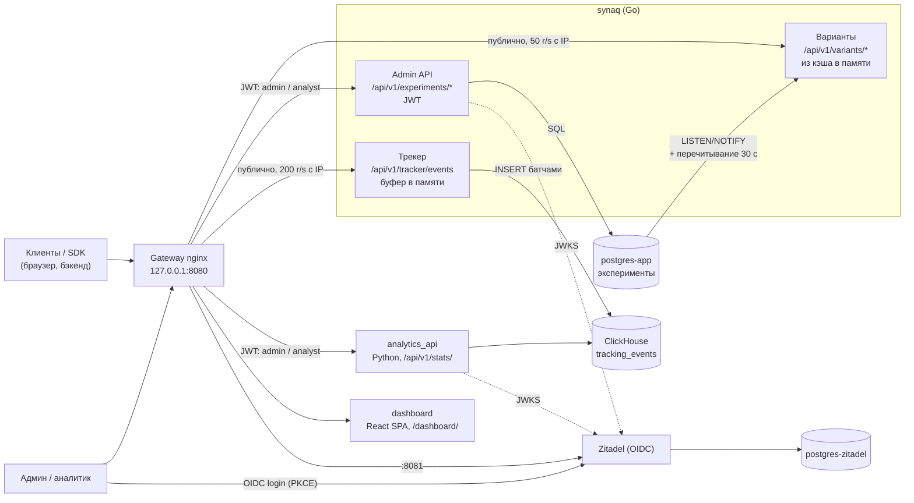

<div align="center">
  <h1>SynaqCore</h1>
  <p><b>Self-hosted платформа серверных A/B/n-экспериментов на одном VPS 4 ГБ:<br>
  детерминированное распределение из памяти, приём событий прямо в ClickHouse<br>
  и статистика (частотная и байесовская)</b></p>

  <!-- Badges -->
  <p>
    
    
    
    
    
    
    
  </p>

  <p>
    
  </p>
</div>

---

> **Статус.** Портфолио / pet-project, ветка `lite`. Стек поднимается одной командой и рассчитан на self-hosted
> пилот на одном VPS (2 vCPU / 4 ГБ). До продакшена не хватает TLS, полноценного A/B/n-анализа и мониторинга —
> см. [дорожную карту](#дорожная-карта). Предыдущая распределённая Python-версия (Redis, Kafka) доступна по тегу `v1-python`.

## Содержание

- [Архитектура](#архитектура)
- [Быстрый старт](#быстрый-старт)
- [Бюджет памяти](#бюджет-памяти)
- [Ключевые инженерные решения](#ключевые-инженерные-решения)
- [Честные компромиссы lite](#честные-компромиссы-lite)
- [Почему SynaqCore, если есть PostHog](#почему-synaqcore-если-есть-posthog)
- [Конфигурация](#конфигурация)
- [Аутентификация и роли](#аутентификация-и-роли)
- [API](#api)
- [Интеграция и SDK](#интеграция-и-sdk)
- [Аналитика и статистика](#аналитика-и-статистика)
- [Структура репозитория](#структура-репозитория)
- [Тесты и CI](#тесты-и-ci)
- [Дорожная карта](#дорожная-карта)
- [Документация](#документация)

---

## Архитектура

Горячий путь — один Go-процесс `synaq`: он раздаёт варианты из снимка конфигураций в памяти, обслуживает admin API
и принимает события, которые батчами пишет прямо в ClickHouse. Тяжёлая статистика — отдельный Python-сервис.
Redis и брокера сообщений нет.



| Путь | Сервис | Доступ |
|---|---|---|
| `/api/v1/variants/` (`/{name}`, `/batch`, `/active`, `/config/{name}`, `/eval-configs`) | `synaq` | публично, `limit_req` 50 r/s с IP (burst 100) → `429` |
| `/api/v1/experiments/` | `synaq` | JWT: `POST` / `PATCH` / `DELETE` — `admin`; `GET` — `admin` или `analyst` |
| `/api/v1/tracker/events` | `synaq` | публично, `limit_req` 200 r/s с IP (burst 400) → `429` |
| `/health`, `/health/track` | `synaq` | процесс жив / ClickHouse доступен |
| `/api/v1/stats/` | `analytics_api` | JWT: `admin` или `analyst` |
| `/dashboard/` (`/admin` → 302) | `dashboard` | вход через Zitadel |
| `127.0.0.1:8081` | Zitadel | отдельный server-блок gateway (корневые пути Zitadel конфликтуют с путями платформы) |

Наружу публикуется только gateway, и только на `127.0.0.1`. Postgres и ClickHouse доступны лишь во внутренней
сети `ab_testing_net`. Подробно — [docs/SYSTEM_DESIGN.md](docs/SYSTEM_DESIGN.md), обоснование —
[ADR 0002](docs/adr/0002-lite-go-monolith.md).

---

## Быстрый старт

Нужны Docker Engine 24+ с Compose v2, `make`, `curl`, `jq` и Python 3.11+ с `httpx` (есть в `./venv`, если он создан).

```bash
git clone https://github.com/Kebiproger/synaqcore.git && cd synaqcore

# 1. Окружение. Пароли и ключи Zitadel — см. «Конфигурация» ниже.
#    POSTGRES_USER/_PASSWORD/_DB в обоих файлах должны совпадать.
cp apps/.env.apps.example apps/.env.apps
cp infra/.env.infra.example infra/.env.infra
#    ZITADEL_MASTERKEY — свой, ровно 32 символа (менять после первого запуска нельзя);
#    make up откажется стартовать с пустым, образцовым или ключом неверной длины:
tr -dc A-Za-z0-9 </dev/urandom | head -c 32; echo   # вставьте в ZITADEL_MASTERKEY= в infra/.env.infra

# 2. Весь стек: Postgres x2, ClickHouse, Zitadel и его bootstrap, synaq, analytics_api, дашборд, gateway
make up

# 3. JWT сервисного аккаунта synaq-automation (роль admin) в SYNAQ_TOKEN
eval "$(make -s token)"

# 4. Симуляция A/B-теста: 5000 синтетических пользователей, treatment +15% к конверсии
make demo
# с параметрами: make demo DEMO_ARGS="--users 1000 --seed 42 --uplift 0.2"
```

> **Первый запуск — на свежих томах.** Lite использует другие тома, чем Python-версия (`postgres-app`,
> `postgres-zitadel`, ClickHouse только с `01-tables.sql`). Если в этом каталоге раньше запускался старый checkout
> (Python-версия), Zitadel создаст новый инстанс с новым `project_id`, а старые `infra/zitadel/public/oidc.json`
> и `secrets/automation.json` будут указывать на прежний — токены не пройдут проверку `aud`. Перед первым
> `make up` выполните при остановленном стеке:
>
> ```bash
> docker compose down -v   # УДАЛЯЕТ ВСЕ ДАННЫЕ стека (тома Postgres, Zitadel, ClickHouse)
> make zitadel-reset       # удаляет сгенерированные oidc.json / automation.json / bootstrap.pat (спросит подтверждение)
> make up
> ```

Что делает `make demo` (`sdk/demo_simulator.py`, все флаги — `--help`):

1. проверяет шлюз;
2. создаёт (или включает) эксперимент `demo_checkout_button` с вариантами `control` / `treatment` 50/50;
3. распределяет пользователей по вариантам. По умолчанию `--allocation local`: расчёт в памяти через `sdk/python`
   после сверки с сервером на выборке (чтобы не упираться в лимит nginx); `--allocation remote` — запрос к
   `/api/v1/variants/` на каждого пользователя;
4. отправляет события в трекер (`--concurrency`, по умолчанию 50 параллельных запросов);
5. ждёт, пока данные дойдут до ClickHouse (`--stats-timeout`, по умолчанию 60 с), и печатает отчёт `/api/v1/stats/`.

Ожидаемый вывод (сокращённо, числа зависят от seed):

```text
[1/5] Проверка шлюза
[2/5] Эксперимент
[3/5] Распределение по вариантам (режим local)
  Локальный расчёт (sdk/python) совпал с сервером на ... пользователях
[4/5] Отправка событий в трекер
[5/5] Ожидание данных в ClickHouse (до 60 с)

Отчёт /api/v1/stats/demo_checkout_button ...
Статистика
  Относительный uplift:       +...%
  p-value (z-тест):           ...
  P(treatment > control):     ...%
```

Затем откройте дашборд: **http://localhost:8080/dashboard/** — логин `<ZITADEL_FIRSTINSTANCE_ORG_HUMAN_USERNAME>@synaqcore.localhost`
и пароль из `infra/.env.infra` (при первом входе Zitadel попросит его сменить).

Smoke-проверка HTTP-API synaq без основного стека: `make smoke` (поднимает отдельный docker-стенд, прогоняет 59
тестов и сносит его). Остановить стек: `make down`. Все команды: `make help`.

Если `/stats` так и не показал данных: `docker compose logs synaq clickhouse` и `curl http://localhost:8080/health/track`.

---

## Бюджет памяти

Лимиты заданы `mem_limit` в compose-файлах; Go-процессам выставлен `GOMEMLIMIT` ниже лимита, чтобы GC срабатывал
раньше OOM-kill.

| Контейнер | `mem_limit` | Примечание |
|---|---:|---|
| `clickhouse` | 1536 МБ | урезанный конфиг (`infra/clickhouse/config.d`, `users.d`) |
| `zitadel` | 512 МБ | `GOMEMLIMIT=400MiB` |
| `analytics_api` | 512 МБ | Монте-Карло в пуле потоков |
| `synaq` | 256 МБ | `GOMEMLIMIT=192MiB`, буфер событий ≤ 64 МиБ |
| `postgres-app` | 256 МБ | `shared_buffers=64MB` |
| `postgres-zitadel` | 256 МБ | `shared_buffers=32MB` |
| `gateway` | 64 МБ | nginx |
| `dashboard` | 64 МБ | статика |
| **Итого долгоживущие** | **≈ 3.4 ГБ** | остаток 4 ГБ — ОС и page cache |
| `zitadel-dbinit` / `zitadel-setup` / `zitadel-init` | 256 / 512 / 64 МБ | одноразовые, отрабатывают до старта `zitadel` (init — сразу после), пики не складываются |

---

## Ключевые инженерные решения

- **Детерминированное stateless-распределение.** `bucket = int(SHA-256("{user_id}:{experiment}"), 16) % 10000`;
  варианты перебираются в **алфавитном порядке**, выбирается первый, для которого `bucket * total < cumulative * 10000`
  (целочисленная арифметика). Назначения не хранятся: выдача варианта ничего не пишет, а серверные SDK
  (`sdk/python`, `sdk/go`) считают тот же ответ локально. Порядок ключей не используется, потому что Postgres JSONB
  его не сохраняет. Паритет с Python-версией закреплён golden-векторами (`apps/synaq/internal/allocation/testdata/golden.json`).
- **Конфиги в памяти вместо Redis.** Неизменяемый снимок всех экспериментов (активных и выключенных), горячий путь —
  один `atomic.Load`. `/config/{name}` отдаёт и выключенный эксперимент, `/active` и `/eval-configs` фильтруют активные.
  Обновление: сразу после записи через admin API, по Postgres `LISTEN/NOTIFY` (триггер на таблице `experiments`)
  и полным перечитыванием раз в 30 с на случай потерянного уведомления. Если Postgres недоступен, раздаётся
  последний снимок. Gateway ждёт `/readyz` synaq (снимок загружен).
- **Прямая запись в ClickHouse.** Ограниченный буфер (10 000 событий / 64 МиБ), батчи по 1000 событий или раз в
  секунду (`INSERT ... FORMAT JSONEachRow`, async insert), ретраи с backoff. Подробно —
  [docs/clickhouse-kafka/README.md](docs/clickhouse-kafka/README.md).
- **Дедупликация по `event_id`.** `ReplacingMergeTree(timestamp)` с `ORDER BY (event_name, user_id, event_id, toDate(timestamp))`.
  Метрики конверсии считаются через `countDistinct(user_id)`, поэтому несхлопнутые дубликаты на них не влияют.
- **Аналитика — отдельный сервис (bulkhead).** `analytics_api` ходит только в ClickHouse; тяжёлый отчёт не отнимает
  CPU у выдачи вариантов.
- **Fail-closed JWT.** Только RS256, ключи из JWKS Zitadel, проверка `iss`, `aud` (= project_id), `exp` и
  обязательного `jti`; роли — только из проектного claim. OIDC не настроен или JWKS недоступен → `503`.
- **Строгая валидация.** Admin API отвечает `422` в формате FastAPI, но без приведения типов (`"5"` вместо `5` —
  ошибка). Трекер: тело ≤ 64 КБ (`413`), строки ≤ 256 символов, `event_data` ≤ 16 КБ, `timestamp` в окне
  [сейчас − 7 дней, сейчас + 5 минут] (`400`) — иначе одна вставка задевала бы слишком много месячных партиций.
- **Валидация всего, что попадает в SQL.** Запросы `analytics_api` к ClickHouse собираются строкой, поэтому
  `goal_event`, шаги воронки, guardrail-события, сегменты, `metric_field` и `limit` проверяются; в synaq SQL к
  Postgres только параметризованный (sqlc).
- **Отдельный Postgres для Zitadel.** IdP и бизнес-данные не делят ни БД, ни учётки; суперпользователь нужен
  только одноразовому `zitadel-dbinit`.

---

## Честные компромиссы lite

- **Нет Kafka — нет долговременного буфера.** `200` от трекера значит «принято в буфер в памяти», а не «записано».
  Если ClickHouse недоступен, батч, не записанный за 5 попыток (паузы 0.2 → 0.4 → 0.8 → 1.6 с; в худшем случае батч занимает ~3 с, если соединение отклоняется, и до
  ~53 с, если ClickHouse завис (5 × таймаут 10 с + паузы)), отбрасывается с записью
  в лог; буфер заполняется, и клиенты получают `503` + `Retry-After: 1`. При падении процесса содержимое буфера теряется (при
  штатной остановке synaq дописывает его до 5 с). Для A/B-аналитики это приемлемо — потеря доли процента событий
  не меняет вывод, а SDK повторяют отправку; для биллинга — нет.
- **ClickHouse влияет только на приём событий.** Выдача вариантов и admin API от него не зависят: synaq стартует и
  работает и при недоступном ClickHouse (при старте — лишь предупреждение в логе), `/health/track` показывает
  состояние приёмника, а трекер отвечает `503`, когда буфер заполнится.
- **Дедупликация по `event_id` — только при слияниях ClickHouse.** Суммы (например, выручка) до фонового слияния
  могут учесть дубликат.
- **Трекер сам генерирует `event_id`, если клиент его не прислал.** Тогда повтор того же события получит другой id
  и не схлопнется. JS SDK генерирует id на клиенте; серверным клиентам стоит передавать свой идемпотентный ключ
  (например, id заказа) и повторять `503` с ним же.
- **Один инстанс synaq.** Реплики возможны (каждая держит свой снимок), но в lite не настроены.

---

## Почему SynaqCore, если есть PostHog

PostHog, GrowthBook и Statsig зрелее: больше интеграций, фича-флаги, таргетинг, проверенные статистические движки.
**Если вашей команде подходит облако в США или ЕС, бесплатный тариф PostHog Cloud — лучший выбор**: ничего не
нужно администрировать. SynaqCore нужен в другом случае:

- **Self-hosted на 4 ГБ / ~€5 в месяц.** Весь стек помещается в один небольшой VPS. Официальный self-hosted
  деплой PostHog требует ~16 ГБ RAM, тянет Kafka, ClickHouse, Redis и ещё десяток сервисов и позиционируется как
  «hobby» — без поддержки для продакшена.
- **Данные остаются на вашем сервере.** Важно, когда законы о локализации данных (например, 152-ФЗ) или политика
  компании не позволяют отправлять поведенческие данные в зарубежное облако.
- **Нет оплаты за событие.** Стоимость — цена VPS, а не объём трафика.
- **Свой домен — меньше потерь от блокировщиков.** SDK и трекер работают с вашего домена (first-party), их не режут
  списки блокировки сторонней аналитики.
- **Серверное распределение.** Вариант считается детерминированно, Go и Python SDK делают это локально в памяти
  бэкенда без сетевого вызова на запрос.
- **Только A/B.** Нет сессий, heatmaps и продуктовой аналитики — меньше кода, памяти и поверхности атаки. Движок
  статистики (z-тест, интервалы Уилсона, байесовский Монте-Карло) написан на чистом Python и целиком читается.

---

## Конфигурация

В `infra/.env.infra` обязательно задайте (без них `docker compose` не стартует):

| Ключ | Значение |
|------|----------|
| `POSTGRES_USER` / `POSTGRES_PASSWORD` / `POSTGRES_DB` | Учётка `postgres-app` (бизнес-БД synaq). Те же значения — в `apps/.env.apps`. |
| `CLICKHOUSE_PASSWORD` | Пароль ClickHouse; тот же — в `apps/.env.apps`. |
| `ZITADEL_MASTERKEY` | Случайная строка **ровно из 32 символов** (`tr -dc A-Za-z0-9 </dev/urandom \| head -c 32`; `make up` проверяет длину и отказывается от образцового ключа из документации Zitadel). Шифрует данные Zitadel — после первой инициализации её нельзя изменить. |
| `ZITADEL_DATABASE_POSTGRES_ADMIN_USERNAME` / `_PASSWORD` | Суперпользователь `postgres-zitadel`; нужен только одноразовому `zitadel-dbinit`. |
| `ZITADEL_DATABASE_POSTGRES_USER_PASSWORD` | Пароль непривилегированного пользователя `zitadel` (создаётся автоматически). |
| `ZITADEL_FIRSTINSTANCE_ORG_HUMAN_USERNAME` / `_PASSWORD` | Логин и начальный пароль первого администратора (сменится при первом входе). |
| `ZITADEL_BOOTSTRAP_PAT_EXPIRATION` | Срок bootstrap-PAT (ISO-8601, ≈ сейчас + 30 дней): `date -u -d '+30 days' +%Y-%m-%dT00:00:00Z`. Учитывается только при первой инициализации. |

Необязательные: `ZITADEL_APP_DEVMODE` (по умолчанию `true` — разрешает `http://` redirect URI; для HTTPS — `false`),
`GATEWAY_PORT` / `ZITADEL_PORT` (по умолчанию `8080` / `8081`). Параметры трекера в `apps/.env.apps`:
`CH_BUFFER_SIZE`, `CH_MAX_BUFFERED_BYTES`, `CH_BATCH_SIZE`, `CH_FLUSH_INTERVAL`.

> **Не создавайте `.env` в корне репозитория.** Корневой `.env` имеет приоритет над `infra/.env.infra` при
> интерполяции `${...}` в compose и молча переопределит значения.

Корневой `docker-compose.yml` подключает (`include`) `infra/docker-compose.infra.yml`, `apps/docker-compose.apps.yml`
и `nginx/docker-compose.yml`. Образы synaq, `analytics_api` и дашборда собираются из исходников: после изменения кода —
`docker compose up -d --build <сервис>`, затем `docker compose restart gateway` (nginx резолвит имена upstream только при старте).

Zitadel стартует в три шага: `zitadel-dbinit` → `zitadel-setup` (первый инстанс, bootstrap-PAT) → `zitadel`. Затем
одноразовый `zitadel-init` (`infra/zitadel/bootstrap.sh`) создаёт проект, роли `admin` / `analyst`, OIDC-приложение
дашборда и сервисный аккаунт `synaq-automation`. Публичная OIDC-конфигурация — `infra/zitadel/public/oidc.json`,
секрет сервисного аккаунта — `infra/zitadel/secrets/automation.json` (не коммитится). После успешного bootstrap PAT с
правами IAM owner удаляется; повторные запуски без PAT ничего не меняют. Консоль Zitadel: http://localhost:8081/ui/console.

---

## Аутентификация и роли

| Роль | Права |
|------|-------|
| `admin` | Создание, изменение (`PATCH`), остановка и удаление экспериментов; список и статистика. |
| `analyst` | Только чтение: список экспериментов и статистика. |

Первый администратор и `synaq-automation` получают `admin` автоматически. Выдать `analyst`: консоль Zitadel →
**Projects** → `synaqcore` → **Authorizations** → **New** (роль появится в токене после повторного входа).

```bash
eval "$(make -s token)"            # или: export SYNAQ_TOKEN="$(scripts/get_token.sh)"
curl -H "Authorization: Bearer $SYNAQ_TOKEN" http://localhost:8080/api/v1/experiments/
```

---

## API

### Выдача варианта (публично)
```bash
curl "http://localhost:8080/api/v1/variants/landing_button_test?user_id=usr_777"
```
```json
{"experiment_name": "landing_button_test", "user_id": "usr_777", "variant": "B"}
```
Для неизвестного или выключенного эксперимента — `"variant": "control"`. Ещё: `POST /api/v1/variants/batch`
(`{"user_id": "...", "experiments": [...]}`, до 50), `GET /api/v1/variants/active`, `GET /api/v1/variants/config/{name}`,
`GET /api/v1/variants/eval-configs` (веса активных экспериментов для серверных SDK).

### Создание эксперимента (`admin`)
```bash
curl -X POST "http://localhost:8080/api/v1/experiments/" \
  -H "Authorization: Bearer $SYNAQ_TOKEN" \
  -H "Content-Type: application/json" \
  -d '{"name": "landing_button_test", "variants": {"A": 50, "B": 50}}'
```
Веса — целые 1..1 000 000. `PATCH /api/v1/experiments/{name}` — частичное обновление; менять варианты активного
эксперимента нельзя (`409`): сначала остановите его (`{"is_active": false}`).

### Отправка события (публично)
```bash
curl -X POST "http://localhost:8080/api/v1/tracker/events" \
  -H "Content-Type: application/json" \
  -d '{"event_id": "evt_01", "user_id": "usr_777", "event_name": "cta_click",
       "experiment_name": "landing_button_test", "variant": "B", "event_data": "{\"screen\":\"main\"}"}'
```

| Код | Когда |
|---|---|
| `200 {"status":"OK"}` | событие принято в буфер |
| `400` | невалидный JSON, нет `user_id` / `event_name`, поле длиннее 256 символов, `event_data` > 16 КБ, `timestamp` вне окна |
| `413` | тело больше 64 КБ |
| `429` | превышен лимит nginx (200 r/s с IP, burst 400) |
| `503` + `Retry-After: 1` | буфер переполнен — повторите позже с тем же `event_id` |

### Статистика (`admin` или `analyst`)
```bash
curl "http://localhost:8080/api/v1/stats/landing_button_test?goal_event=cta_click&method=both" \
  -H "Authorization: Bearer $SYNAQ_TOKEN"
```
Параметры: `method` (`frequentist` | `bayesian` | `both`), `goal_event` (по умолчанию `purchase`), `segments`, `hide`,
`monthly_traffic`; краткий отчёт — `/api/v1/stats/{name}/basic`.

---

## Интеграция и SDK

- **[Руководство по интеграции](docs/INTEGRATION_GUIDE.md)** — сетевая изоляция, корпоративный nginx, клиентские и
  серверные примеры, M2M-автоматизация.
- **JavaScript / TypeScript SDK** ([`sdk/README.md`](sdk/README.md)): [`sdk/synaq.js`](sdk/synaq.js) без зависимостей,
  типы [`sdk/synaq.d.ts`](sdk/synaq.d.ts); кэш вариантов, `getVariantsBatch(...)`, буферизация событий, `sendBeacon`,
  генерация `event_id` на клиенте. Gateway раздаёт файл по `/sdk/synaq.js`.
- **React:** [`sdk/react.jsx`](sdk/react.jsx) — `<SynaqProvider>` и хук `useVariant`.
- **Серверные SDK с локальным расчётом:** [`sdk/python`](sdk/python) и [`sdk/go`](sdk/go) — опрашивают
  `/api/v1/variants/eval-configs` (раз в 30 с) и считают вариант в памяти тем же алгоритмом.
- **Корпоративный nginx:** [`nginx/company-edge-integration.example.conf`](nginx/company-edge-integration.example.conf).

---

## Аналитика и статистика

Движок `apps/analytics_api/src/services/analysis/` (на `math` / `random`, без scipy): двусторонний z-тест для долей,
интервалы Уилсона, ДИ разницы и uplift; байесовский Монте-Карло по Beta-апостериорным (P(variant > control),
expected loss); бизнес-метрики (выручка, ARPU, guardrails, MDE), сегменты, воронка; рекомендации на русском.
Ограничение: сравниваются контроль (`A` или `control`) и **один** другой вариант.

Схема ClickHouse — [`infra/clickhouse/init/01-tables.sql`](infra/clickhouse/init/01-tables.sql): `tracking_events`
(`ReplacingMergeTree(timestamp)`, `PARTITION BY toYYYYMM(timestamp)`, колонки `DEFAULT ''` вместо `Nullable`).
При изменении формата события синхронно меняются трекер synaq, таблица и SDK.

---

## Структура репозитория

```
synaqcore/
├── apps/
│   ├── synaq/                   # Go-монолит: варианты, admin API, трекер
│   │   ├── cmd/synaq/           # точка входа
│   │   └── internal/            # allocation, api (variants, admin, validate), auth, configcache,
│   │                            # store (Postgres, миграции, sqlc), sink/clickhouse, track
│   ├── analytics_api/           # FastAPI: /api/v1/stats, ClickHouse-агрегатор, движок статистики
│   ├── dashboard/               # SPA (React + Vite + Tailwind)
│   └── docker-compose.apps.yml
├── infra/
│   ├── clickhouse/              # init/01-tables.sql, low-memory конфиг
│   ├── zitadel/                 # bootstrap.sh (zitadel-init), public/, secrets/
│   └── docker-compose.infra.yml # postgres-app, postgres-zitadel, Zitadel, ClickHouse
├── nginx/                       # nginx.conf шлюза, пример для корпоративного edge
├── scripts/get_token.sh         # JWT сервисного аккаунта
├── sdk/                         # JS/TS SDK, React, sdk/python, sdk/go, demo_simulator.py
├── tests/                       # pytest (analytics, SDK), contract/ (smoke synaq), load/ (Locust)
├── docs/                        # архитектура, ADR, планы
├── Makefile                     # up / down / token / demo / test / lint / go-test / smoke / zitadel-reset
└── docker-compose.yml           # include всех compose-файлов
```

---

## Тесты и CI

```bash
make go-test   # go test -race: apps/synaq (распределение, API, auth, кэш, ClickHouse-приёмник) и sdk/go
make smoke     # 59 HTTP-тестов synaq на отдельном docker-стенде (Postgres + ClickHouse + JWKS), сам сносит стенд
make test      # pytest: analytics_api (движок, агрегатор, auth, роутер /stats) и Python SDK против golden-векторов
make lint      # ruff check apps tests sdk
```

`./venv/bin` скрипты имеют сломанный shebang, поэтому `make` вызывает инструменты через `python -m`.

GitHub Actions (`.github/workflows/ci.yml`): ruff + pytest; gofmt + go vet + go test + go build для `apps/synaq` и
`sdk/go`; smoke-набор; typecheck и сборка дашборда; сборка Docker-образов. Actions закреплены по SHA, обновления — Dependabot.

Нагрузочный тест: `eval "$(make -s token)" && locust -f tests/load/locustfile.py --host http://localhost:8080`
(с одной машины упрётесь в `limit_req` nginx — ответы `429`).

---

## Дорожная карта

- **Дисковый spool** для буфера трекера — события переживают рестарт и долгую недоступность ClickHouse.
- **Реплики synaq** за gateway.
- **`/metrics` + профиль Grafana** (RPS, latency, `503`, отброшенные батчи, возраст снимка конфигов).
- **Caddy с auto-TLS** и Zitadel на `auth.<domain>`.
- **Установка одной командой** (генерация секретов, проверка ресурсов).
- **Бэкап и восстановление** Postgres и ClickHouse.
- **Профиль `scale`** с Kafka/Redpanda как долговременным буфером — в той же кодовой базе.
- A/B/n-анализ с поправкой на множественные проверки.

Python-версия (FastAPI `experiment_api` + Redis, трекер → Redpanda → ClickHouse Kafka engine) остаётся доступной по
тегу `v1-python`. Подробно: [docs/plan.md](docs/plan.md), статус — [docs/SESSION_CONTEXT.md](docs/SESSION_CONTEXT.md).

---

## Документация

- [docs/SYSTEM_DESIGN.md](docs/SYSTEM_DESIGN.md) — архитектура lite
- [docs/adr/0002-lite-go-monolith.md](docs/adr/0002-lite-go-monolith.md) — ADR: Go-монолит на одном VPS
- [docs/adr/0001-kafka-vs-rabbitmq.md](docs/adr/0001-kafka-vs-rabbitmq.md) — ADR: Kafka (Python-версия и профиль `scale`)
- [docs/clickhouse-kafka/README.md](docs/clickhouse-kafka/README.md) — приём событий в ClickHouse
- [docs/INTEGRATION_GUIDE.md](docs/INTEGRATION_GUIDE.md) — интеграция
- [docs/plan.md](docs/plan.md) — дорожная карта

## Лицензия

Планируется MIT; файл `LICENSE` пока не добавлен в репозиторий.
