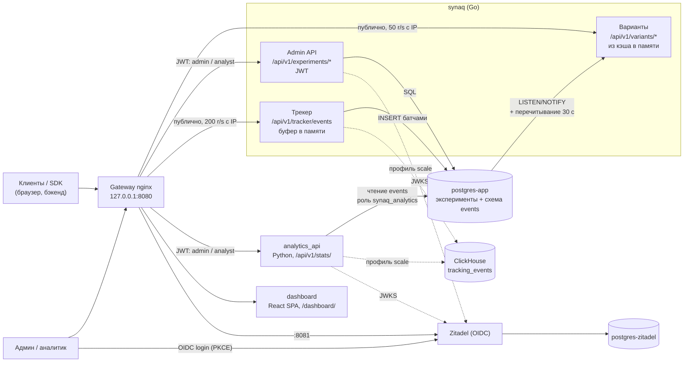

<div align="center">
  <h1>SynaqCore</h1>
  <p><b>Self-hosted платформа серверных A/B/n-экспериментов на одном небольшом VPS (2 ГБ):<br>
  детерминированное распределение из памяти, события сразу в PostgreSQL<br>
  и статистика (частотная и байесовская); ClickHouse — по желанию, профиль <code>scale</code></b></p>

  <!-- Badges -->
  <p>
    
    
    
    
    
    
    
  </p>

  <p>
    
  </p>
</div>

---

> **Статус.** Портфолио / pet-project. Стек поднимается одной командой и рассчитан на self-hosted пилот на одном
> VPS (2 vCPU / 2 ГБ; профиль `scale` с ClickHouse — от 4 ГБ). До продакшена не хватает TLS, полноценного
> A/B/n-анализа и мониторинга — см. [дорожную карту](#дорожная-карта). Предыдущая распределённая Python-версия
> (Redis, Kafka) доступна по тегу `v1-python`.

## Содержание

- [Архитектура](#архитектура)
- [Быстрый старт](#быстрый-старт)
- [Бюджет памяти](#бюджет-памяти)
- [Ключевые инженерные решения](#ключевые-инженерные-решения)
- [Честные компромиссы](#честные-компромиссы)
- [Сколько места займут события](#сколько-места-займут-события)
- [Почему SynaqCore, если есть PostHog](#почему-synaqcore-если-есть-posthog)
- [Конфигурация](#конфигурация)
- [Аутентификация и роли](#аутентификация-и-роли)
- [API](#api)
- [Интеграция и SDK](#интеграция-и-sdk)
- [Аналитика и статистика](#аналитика-и-статистика)
- [Структура репозитория](#структура-репозитория)
- [Тесты и CI](#тесты-и-ci)
- [Дорожная карта](#дорожная-карта)
- [Документация](#документация)

---

## Архитектура

Горячий путь — один Go-процесс `synaq`: он раздаёт варианты из снимка конфигураций в памяти, обслуживает admin API
и принимает события, которые батчами пишет в схему `events` того же `postgres-app` (сырые события, суточные
партиции). Тяжёлая статистика — отдельный Python-сервис. Redis и брокера сообщений нет. ClickHouse — необязательный
профиль `scale` (`make up-scale`), в стек по умолчанию не входит. Рассчитано на нагрузку до ~100 событий/с в пике.



| Путь | Сервис | Доступ |
|---|---|---|
| `/api/v1/variants/` (`/{name}`, `/batch`, `/active`, `/config/{name}`, `/eval-configs`) | `synaq` | публично, `limit_req` 50 r/s с IP (burst 100) → `429` |
| `/api/v1/experiments/` | `synaq` | JWT: `POST` / `PATCH` / `DELETE` — `admin`; `GET` — `admin` или `analyst` |
| `/api/v1/tracker/events` | `synaq` | публично, `limit_req` 200 r/s с IP (burst 400) → `429` |
| `/health`, `/health/track` | `synaq` | процесс жив / хранилище событий доступно |
| `/api/v1/stats/` | `analytics_api` | JWT: `admin` или `analyst` |
| `/dashboard/` (`/admin` → 302) | `dashboard` | вход через Zitadel |
| `127.0.0.1:8081` | Zitadel | отдельный server-блок gateway (корневые пути Zitadel конфликтуют с путями платформы) |

Наружу публикуется только gateway, и только на `127.0.0.1`. Postgres и ClickHouse доступны лишь во внутренней
сети `ab_testing_net`. Подробно — [docs/SYSTEM_DESIGN.md](docs/SYSTEM_DESIGN.md), обоснование —
[ADR 0002](docs/adr/0002-lite-go-monolith.md) и [ADR 0003](docs/adr/0003-postgres-default-event-store.md)
(Postgres как хранилище событий по умолчанию).

---

## Быстрый старт

Нужны Docker Engine 24+ с **Docker Compose ≥ 2.20** (корневой `docker-compose.yml` использует `include` с `env_file`), `make`, `curl`, `jq` и Python 3.11+ с `httpx` (есть в `./venv`, если он создан).

```bash
git clone https://github.com/Kebiproger/synaqcore.git && cd synaqcore

# 1. Окружение. Секреты БД и Zitadel живут только в infra/.env.infra (см. «Конфигурацию» ниже);
#    apps/.env.apps хранит лишь необязательную настройку буферов.
cp apps/.env.apps.example apps/.env.apps
cp infra/.env.infra.example infra/.env.infra
#    Сгенерируйте и вставьте в infra/.env.infra (по одному запуску команды на каждый ключ):
#      ZITADEL_MASTERKEY=      ровно 32 символа, менять после первого запуска нельзя
#      SYNAQ_DB_PASSWORD=      пароль роли synaq_app, не короче 16 символов
#      ANALYTICS_DB_PASSWORD=  пароль роли synaq_analytics, не короче 16 и отличается от предыдущего
#    make up откажется стартовать с пустыми, образцовыми, короткими или одинаковыми значениями:
tr -dc A-Za-z0-9 </dev/urandom | head -c 32; echo

# 2. Стек по умолчанию: postgres-app (эксперименты и события), postgres-zitadel, Zitadel и его bootstrap,
#    synaq, analytics_api, дашборд, gateway. ClickHouse не запускается.
make up
#    С ClickHouse вместо Postgres как хранилища событий (нужен CLICKHOUSE_PASSWORD, ≥ 4 ГБ RAM): make up-scale

# 3. JWT сервисного аккаунта synaq-automation (роль admin) в SYNAQ_TOKEN
eval "$(make -s token)"

# 4. Симуляция A/B-теста: 5000 синтетических пользователей, treatment +15% к конверсии
make demo
# с параметрами: make demo DEMO_ARGS="--users 1000 --seed 42 --uplift 0.2"
```

> **Первый запуск — на свежих томах.** Текущий стек использует другие тома, чем Python-версия (`postgres-app`,
> `postgres-zitadel`, ClickHouse — только в профиле `scale`). Если в этом каталоге раньше запускался старый checkout
> (Python-версия), Zitadel создаст новый инстанс с новым `project_id`, а старые `infra/zitadel/public/oidc.json`
> и `secrets/automation.json` будут указывать на прежний — токены не пройдут проверку `aud`. Перед первым
> `make up` выполните при остановленном стеке:
>
> ```bash
> docker compose down -v   # УДАЛЯЕТ ВСЕ ДАННЫЕ стека (тома Postgres, Zitadel, ClickHouse)
> make zitadel-reset       # удаляет сгенерированные oidc.json / automation.json / bootstrap.pat (спросит подтверждение)
> make up
> ```

Что делает `make demo` (`sdk/demo_simulator.py`, все флаги — `--help`):

1. проверяет шлюз;
2. создаёт (или включает) эксперимент `demo_checkout_button` с вариантами `control` / `treatment` 50/50;
3. распределяет пользователей по вариантам. По умолчанию `--allocation local`: расчёт в памяти через `sdk/python`
   после сверки с сервером на выборке (чтобы не упираться в лимит nginx); `--allocation remote` — запрос к
   `/api/v1/variants/` на каждого пользователя;
4. отправляет события в трекер (`--concurrency`, по умолчанию 50 параллельных запросов);
5. ждёт, пока данные дойдут до хранилища событий (`--stats-timeout`, по умолчанию 60 с), и печатает отчёт `/api/v1/stats/`.

Ожидаемый вывод (сокращённо, числа зависят от seed):

```text
[1/5] Проверка шлюза
[2/5] Эксперимент
[3/5] Распределение по вариантам (режим local)
  Локальный расчёт (sdk/python) совпал с сервером на ... пользователях
[4/5] Отправка событий в трекер
[5/5] Ожидание данных в хранилище событий (до 60 с)

Отчёт /api/v1/stats/demo_checkout_button ...
Статистика
  Относительный uplift:       +...%
  p-value (z-тест):           ...
  P(treatment > control):     ...%
```

Затем откройте дашборд: **http://localhost:8080/dashboard/** — логин `<ZITADEL_FIRSTINSTANCE_ORG_HUMAN_USERNAME>@synaqcore.localhost`
и пароль из `infra/.env.infra` (при первом входе Zitadel попросит его сменить).

Smoke-проверка HTTP-API synaq без основного стека: `make smoke` (события в Postgres) или `make smoke-ch`
(события в ClickHouse) — поднимает отдельный docker-стенд, прогоняет 59 тестов и сносит его. Остановить стек:
`make down`. Все команды: `make help`.

Если `/stats` так и не показал данных: `docker compose logs synaq postgres-app` (в профиле `scale` — `clickhouse`) и
`curl http://localhost:8080/health/track`.

> **Обновление с предыдущей версии (события были в ClickHouse).**
> 1. В `infra/.env.infra` добавьте `SYNAQ_DB_PASSWORD` и `ANALYTICS_DB_PASSWORD` (≥ 16 символов, разные), иначе
>    `docker compose` и `make up` не стартуют.
> 2. `apps/.env.apps` больше не несёт секретов БД: `POSTGRES_USER` / `POSTGRES_PASSWORD` из него теперь перекрываются
>    значениями из compose (synaq ходит под ролью `synaq_app`, а не суперпользователем) и игнорируются.
> 3. На существующем томе `postgres-app` роли создаст одноразовый `postgres-app-init` при ближайшем `up`
>    (скрипт идемпотентен; объекты, созданные под суперпользователем, он передаёт `synaq_app`).
> 4. **События из ClickHouse в Postgres не переносятся.** Старые события остаются в томе ClickHouse и видны только
>    с профилем `scale`; в стеке по умолчанию отчёты начнутся с пустой таблицы `events`.

---

## Бюджет памяти

Лимиты заданы `mem_limit` в compose-файлах; Go-процессам выставлен `GOMEMLIMIT` ниже лимита, чтобы GC срабатывал
раньше OOM-kill. Стек по умолчанию рассчитан на VPS с 2 ГБ.

| Контейнер | `mem_limit` | Примечание |
|---|---:|---|
| `postgres-app` | 448 МБ | эксперименты и события; `shared_buffers=96MB` |
| `zitadel` | 448 МБ | `GOMEMLIMIT=360MiB` |
| `analytics_api` | 320 МБ | Монте-Карло в пуле потоков |
| `postgres-zitadel` | 192 МБ | `shared_buffers=32MB` |
| `synaq` | 160 МБ | `GOMEMLIMIT=128MiB`, буфер событий ≤ 32 МиБ |
| `gateway` | 64 МБ | nginx |
| `dashboard` | 64 МБ | статика |
| **Итого долгоживущие** | **1696 МБ (≈ 1.7 ГБ)** | остаток 2 ГБ (≈ 0.3 ГБ) — ОС и page cache |
| `clickhouse` (только профиль `scale`) | 1536 МБ | урезанный конфиг (`infra/clickhouse/config.d`, `users.d`); с ним итого ≈ 3.2 ГБ |
| `postgres-app-init` / `zitadel-dbinit` / `zitadel-setup` / `zitadel-init` | 64 / 256 / 512 / 64 МБ | одноразовые, отрабатывают до старта `zitadel` (init — сразу после), пики не складываются |

Это верхние границы, а не измеренное потребление (фактический RSS не снимался). На 2 ГБ запас по page cache
небольшой: Postgres будет чаще читать с диска, а `/stats` по большим окнам — медленнее. Если планируете держать
долго и много событий, берите 4 ГБ.

---

## Ключевые инженерные решения

- **Детерминированное stateless-распределение.** `bucket = int(SHA-256("{user_id}:{experiment}"), 16) % 10000`;
  варианты перебираются в **алфавитном порядке**, выбирается первый, для которого `bucket * total < cumulative * 10000`
  (целочисленная арифметика). Назначения не хранятся: выдача варианта ничего не пишет, а серверные SDK
  (`sdk/python`, `sdk/go`) считают тот же ответ локально. Порядок ключей не используется, потому что Postgres JSONB
  его не сохраняет. Паритет с Python-версией закреплён golden-векторами (`apps/synaq/internal/allocation/testdata/golden.json`).
- **Конфиги в памяти вместо Redis.** Неизменяемый снимок всех экспериментов (активных и выключенных), горячий путь —
  один `atomic.Load`. `/config/{name}` отдаёт и выключенный эксперимент, `/active` и `/eval-configs` фильтруют активные.
  Обновление: сразу после записи через admin API, по Postgres `LISTEN/NOTIFY` (триггер на таблице `experiments`)
  и полным перечитыванием раз в 30 с на случай потерянного уведомления. Если Postgres недоступен, раздаётся
  последний снимок. Gateway ждёт `/readyz` synaq (снимок загружен).
- **События — в PostgreSQL по умолчанию** ([ADR 0003](docs/adr/0003-postgres-default-event-store.md)). Ожидаемая
  нагрузка — до ~100 событий/с в пике; для неё отдельная колоночная СУБД избыточна, а её 1.5 ГБ не помещаются в 2 ГБ.
  Сырые события лежат в `events.tracking_events` того же `postgres-app`, партиции по UTC-дням.
- **Партиции ведёт сам synaq, без pg_partman.** Он создаёт партиции на дни от сегодня−7 до сегодня+`EVENTS_PARTITIONS_AHEAD`
  и удаляет партиции старше `EVENTS_RETENTION_DAYS` (по умолчанию 90, минимум 8) — `DROP` партиции вместо долгого
  `DELETE`. Работает под advisory-lock, чтобы реплики не мешали друг другу.
- **Запись: ограниченный буфер и отдельный пул.** Буфер (10 000 событий / 32 МиБ), батчи до 500 событий или раз в
  секунду, один `INSERT ... SELECT FROM unnest(...) ON CONFLICT DO NOTHING`, ретраи с backoff. Для событий свой пул
  pgx (по умолчанию 2 соединения, `PG_EVENTS_MAX_CONNS`) с `synchronous_commit=off` и `statement_timeout=10s`: запись
  событий не отнимает соединения у выдачи вариантов. Профиль ClickHouse описан в
  [docs/clickhouse-kafka/README.md](docs/clickhouse-kafka/README.md).
- **Дедупликация первичным ключом.** `PRIMARY KEY (event_id, user_id, event_name, event_date)` (UTC-день),
  `ON CONFLICT DO NOTHING`: **остаётся первая** строка, дубликат отбрасывается сразу при вставке. В ClickHouse
  (`ReplacingMergeTree`) дубликаты схлопываются только при фоновых слияниях и остаётся последняя.
- **Права по минимуму.** Приложения не используют суперпользователя: `synaq_app` владеет схемами `public` и `events`,
  `synaq_analytics` только читает `events` (`default_transaction_read_only`, `statement_timeout=15s`). Роли создаёт
  идемпотентный одноразовый `postgres-app-init`; суперпользователь есть только в нём и в самом `postgres-app`.
- **Аналитика — отдельный сервис (bulkhead).** `analytics_api` ходит только в хранилище событий (`EVENTS_BACKEND`);
  тяжёлый отчёт не отнимает CPU у выдачи вариантов.
- **Fail-closed JWT.** Только RS256, ключи из JWKS Zitadel, проверка `iss`, `aud` (= project_id), `exp` и
  обязательного `jti`; роли — только из проектного claim. OIDC не настроен или JWKS недоступен → `503`.
- **Строгая валидация.** Admin API отвечает `422` в формате FastAPI, но без приведения типов (`"5"` вместо `5` —
  ошибка). Трекер: тело ≤ 64 КБ (`413`), строки ≤ 256 символов, `event_data` ≤ 16 КБ, `timestamp` в окне
  [сейчас − 7 дней, сейчас + 5 минут] (`400`) — иначе одна вставка задевала бы слишком много партиций (в ClickHouse —
  месячных, в Postgres — суточных, а их создаёт synaq только в окне сегодня−7 .. сегодня+`EVENTS_PARTITIONS_AHEAD`).
- **Валидация всего, что попадает в SQL.** Запросы `analytics_api` к ClickHouse собираются строкой, поэтому
  `goal_event`, шаги воронки, guardrail-события, сегменты, `metric_field` и `limit` проверяются; Postgres-режим
  `analytics_api` и весь SQL synaq к Postgres параметризованы.
- **Отдельный Postgres для Zitadel.** IdP и бизнес-данные не делят ни БД, ни учётки; суперпользователь нужен
  только одноразовому `zitadel-dbinit`.

---

## Честные компромиссы

- **Нет Kafka — нет долговременного буфера.** `200` от трекера значит «принято в буфер в памяти», а не «записано».
  Если хранилище недоступно, батч, не записанный за 5 попыток (паузы 0.2 → 0.4 → 0.8 → 1.6 с; в худшем случае батч
  занимает ~3 с, если соединение отклоняется, и до ~53 с, если ClickHouse завис (5 × таймаут 10 с + паузы)),
  отбрасывается с записью в лог; буфер заполняется, и клиенты получают `503` + `Retry-After: 1`. При падении
  процесса содержимое буфера теряется (при штатной остановке synaq дописывает его до 5 с). Для A/B-аналитики это
  приемлемо — потеря доли процента событий не меняет вывод, а SDK повторяют отправку; для биллинга — нет.
- **`synchronous_commit=off` в Postgres-режиме.** Коммит событий не ждёт fsync, поэтому при падении сервера Postgres
  или хоста можно потерять примерно последнюю секунду уже принятых (`200`) событий — вместе с событиями, ещё не
  выписанными из буфера synaq, это потери порядка секунды трафика. Данные экспериментов этого не касается:
  админский пул `synaq` работает с обычным `synchronous_commit`.
- **Хранилище событий влияет только на приём событий.** Выдача вариантов и admin API от него не зависят: synaq
  стартует и работает и при недоступном ClickHouse (при старте — лишь предупреждение в логе), `/health/track`
  показывает состояние приёмника, а трекер отвечает `503`, когда буфер заполнится. В Postgres-режиме
  `postgres-app` — общая зависимость: без него synaq не стартует (миграции, снимок конфигураций); уже запущенный
  продолжает раздавать варианты из последнего снимка.
- **Postgres-режим отдаёт упрощённый отчёт.** Нет сегментов, воронки и выбросов. В ответе `/stats` появляются
  `"backend": "postgres"` и `"unsupported_sections": ["segmentation", "funnel", "outliers"]`; явный параметр
  `segments=` даёт `400`. Выручка `|x| ≥ 1e15` считается как 0. `total_events` может быть немного ниже, чем в
  ClickHouse: в Postgres дубликаты не попадают в таблицу совсем (первая строка побеждает), в ClickHouse они
  учитываются до слияния. Полный отчёт — только в профиле `scale`.
- **Старые события из ClickHouse не переносятся.** Миграции данных ClickHouse → Postgres нет.
- **Postgres не колоночная СУБД.** Отчёт читает сырые события по эксперименту через индекс; на ~100 событий/с в
  пике это приемлемо, на десятках миллионов строк за окно запросы замедлятся (`statement_timeout` роли аналитики —
  15 с). Дальше — профиль `scale`.
- **Дедупликация — по ключу `(event_id, user_id, event_name, UTC-день)`.** Повтор с тем же `event_id` в другой UTC-день
  не схлопнется. В ClickHouse дубликаты схлопываются только при слияниях, и суммы (выручка) до слияния могут учесть
  дубликат.
- **Трекер сам генерирует `event_id`, если клиент его не прислал.** Тогда повтор того же события получит другой id
  и не схлопнется. JS SDK генерирует id на клиенте; серверным клиентам стоит передавать свой идемпотентный ключ
  (например, id заказа) и повторять `503` с ним же.
- **Один инстанс synaq.** Реплики возможны (каждая держит свой снимок), но не настроены.

---

## Сколько места займут события

Оценка по измерению, а не по документации. На одноразовом `postgres:16-alpine` применена миграция
`00003_events.sql`, созданы суточные партиции и вставлено по 500 000 синтетических событий двух форм;
`pg_total_relation_size` партиции (куча + первичный ключ + индекс по эксперименту, без WAL и без раздувания)
делится на число строк:

| Форма `event_data` | байт на событие, всего | из них индексы |
|---|---:|---:|
| `{"revenue": 19.9}` | 415 | ~238 |
| как у `make demo` (`platform`, `user_tenure`, `source`, `revenue`, `currency`) | 509 | ~239 |

Индексы весят больше половины: первичный ключ из четырёх текстовых колонок и индекс по эксперименту. Ниже —
**оценка** по 509 байт/событие, округлённо; реальные `user_id`/`event_id` длиннее или короче, повторяющиеся
`user_id` в индексе сжимаются лучше (в измерении почти все были уникальны, то есть индекс завышен), а WAL и
раздувание таблицы в оценку не входят — закладывайте запас ×1.3–1.5.

| Средняя нагрузка, событий/с | событий в сутки | ГБ в сутки | ГБ при хранении 90 дней |
|---:|---:|---:|---:|
| 1 | 86 400 | 0.04 | ≈ 4 |
| 5 | 432 000 | 0.22 | ≈ 20 |
| 10 | 864 000 | 0.44 | ≈ 40 |
| 25 | 2 160 000 | 1.1 | ≈ 99 |
| 100 | 8 640 000 | 4.4 | ≈ 396 |

Ориентир ~100 событий/с — это **пик**, а не среднее: средняя нагрузка пилота обычно на порядок ниже (единицы
событий/с), то есть десятки ГБ за 90 дней. Постоянные 100 событий/с на 90 дней — уже сотни ГБ: берите диск
соответственно или уменьшайте `EVENTS_RETENTION_DAYS`.

---

## Почему SynaqCore, если есть PostHog

PostHog, GrowthBook и Statsig зрелее: больше интеграций, фича-флаги, таргетинг, проверенные статистические движки.
*Цифры о PostHog ниже не перепроверялись по актуальной документации.* **Если вашей команде подходит облако в США или ЕС, бесплатный тариф PostHog Cloud — лучший выбор**: ничего не
нужно администрировать. SynaqCore нужен в другом случае:

- **Self-hosted на 2 ГБ / ~€5 в месяц.** Весь стек (без ClickHouse) помещается в один небольшой VPS. Официальный self-hosted
  деплой PostHog требует ~16 ГБ RAM, тянет Kafka, ClickHouse, Redis и ещё десяток сервисов и позиционируется как
  «hobby» — без поддержки для продакшена.
- **Данные остаются на вашем сервере.** Важно, когда законы о локализации данных (например, 152-ФЗ) или политика
  компании не позволяют отправлять поведенческие данные в зарубежное облако.
- **Нет оплаты за событие.** Стоимость — цена VPS, а не объём трафика.
- **Свой домен — меньше потерь от блокировщиков.** SDK и трекер работают с вашего домена (first-party), их не режут
  списки блокировки сторонней аналитики.
- **Серверное распределение.** Вариант считается детерминированно, Go и Python SDK делают это локально в памяти
  бэкенда без сетевого вызова на запрос.
- **Только A/B.** Нет сессий, heatmaps и продуктовой аналитики — меньше кода, памяти и поверхности атаки. Движок
  статистики (z-тест, интервалы Уилсона, байесовский Монте-Карло) написан на чистом Python и целиком читается.

---

## Конфигурация

Секреты и ключи хранятся **только в `infra/.env.infra`**: корневой `docker-compose.yml` подставляет его в compose всех
сервисов. В `infra/.env.infra` обязательно задайте (без них `docker compose` не стартует):

| Ключ | Значение |
|------|----------|
| `POSTGRES_USER` / `POSTGRES_PASSWORD` / `POSTGRES_DB` | Суперпользователь и база `postgres-app`. Видны только самому `postgres-app` и `postgres-app-init`; имя пользователя не должно быть `synaq_app` / `synaq_analytics`. |
| `SYNAQ_DB_PASSWORD` | Пароль роли `synaq_app` (владелец схем `public` и `events`; под ней работает synaq). Не короче 16 символов. |
| `ANALYTICS_DB_PASSWORD` | Пароль роли `synaq_analytics` (только чтение `events`; под ней работает `analytics_api`). Не короче 16 символов и **отличается** от `SYNAQ_DB_PASSWORD`. |
| `ZITADEL_MASTERKEY` | Случайная строка **ровно из 32 символов** (`tr -dc A-Za-z0-9 </dev/urandom \| head -c 32`; `make up` проверяет длину и отказывается от образцового ключа из документации Zitadel). Шифрует данные Zitadel — после первой инициализации её нельзя изменить. |
| `ZITADEL_DATABASE_POSTGRES_ADMIN_USERNAME` / `_PASSWORD` | Суперпользователь `postgres-zitadel`; нужен только одноразовому `zitadel-dbinit`. |
| `ZITADEL_DATABASE_POSTGRES_USER_PASSWORD` | Пароль непривилегированного пользователя `zitadel` (создаётся автоматически). |
| `ZITADEL_FIRSTINSTANCE_ORG_HUMAN_USERNAME` / `_PASSWORD` | Логин и начальный пароль первого администратора (сменится при первом входе). |
| `ZITADEL_BOOTSTRAP_PAT_EXPIRATION` | Срок bootstrap-PAT (ISO-8601, ≈ сейчас + 30 дней): `date -u -d '+30 days' +%Y-%m-%dT00:00:00Z`. Учитывается только при первой инициализации. |

`make up` дополнительно проверяет оба пароля ролей (`make check-db-passwords`); сами роли создаёт
`postgres-app-init` при каждом `up` (пароли ролей применяются заново, смена пароля в `infra/.env.infra` вступает в силу
после перезапуска `postgres-app-init`, затем нужно пересоздать `synaq` и `analytics_api`).

Профиль `scale` (ClickHouse, `make up-scale`): дополнительно `CLICKHOUSE_PASSWORD` (проверяет
`make check-clickhouse-password`) и `EVENT_STORE=clickhouse` (`make up-scale` выставляет его сам).

Необязательные в `infra/.env.infra`: `EVENT_STORE` (`postgres` по умолчанию | `clickhouse`; его же получают synaq —
как `EVENT_SINK` — и `analytics_api` — как `EVENTS_BACKEND`), `ZITADEL_APP_DEVMODE` (по умолчанию `true` — разрешает
`http://` redirect URI; для HTTPS — `false`), `GATEWAY_PORT` / `ZITADEL_PORT` (по умолчанию `8080` / `8081`).

Настройка хранилища событий synaq (все необязательны; значения по умолчанию заданы в коде, переопределяются в
`apps/.env.apps`). Исключение — `PG_EVENTS_MAX_CONNS`: он явно прописан в `environment:` сервиса `synaq`
(`${PG_EVENTS_MAX_CONNS:-2}`), а запись в `environment:` перекрывает `env_file`, поэтому значение из `apps/.env.apps`
игнорируется. Задавайте его только в `infra/.env.infra` (или переменной shell при запуске compose):

| Ключ | По умолчанию | Значение |
|------|:---:|----------|
| `EVENTS_RETENTION_DAYS` | 90 | Срок хранения сырых событий, дни (минимум 8); старые суточные партиции удаляются. |
| `EVENTS_PARTITIONS_AHEAD` | 3 | На сколько дней вперёд создавать партиции (1..30). |
| `PG_EVENTS_MAX_CONNS` | 2 | Размер отдельного пула записи событий (1..100). Только `infra/.env.infra` / shell, не `apps/.env.apps`. |
| `EVENTS_BUFFER_SIZE` | 10000 | Ёмкость очереди событий; полна → `503`. |
| `EVENTS_MAX_BUFFERED_BYTES` | 33554432 | Лимит байт в очереди и незаписанных батчах (32 МиБ). |
| `EVENTS_BATCH_SIZE` | 500 | Максимум событий в одном `INSERT`. |
| `EVENTS_FLUSH_INTERVAL` | `1s` | Максимальное ожидание неполного батча. |
| `CH_BUFFER_SIZE`, `CH_MAX_BUFFERED_BYTES`, `CH_BATCH_SIZE`, `CH_FLUSH_INTERVAL` | 10000, 64 МиБ, 1000, `1s` | То же для профиля `scale` (ClickHouse). |

> **Не создавайте `.env` в корне репозитория.** Корневой `.env` имеет приоритет над `infra/.env.infra` при
> интерполяции `${...}` в compose и молча переопределит значения.

Корневой `docker-compose.yml` подключает (`include`, нужен Compose ≥ 2.20) `infra/docker-compose.infra.yml`,
`apps/docker-compose.apps.yml` и `nginx/docker-compose.yml`, передавая всем `infra/.env.infra`. Образы synaq, `analytics_api` и дашборда собираются из исходников: после изменения кода —
`docker compose up -d --build <сервис>`, затем `docker compose restart gateway` (nginx резолвит имена upstream только при старте).

Zitadel стартует в три шага: `zitadel-dbinit` → `zitadel-setup` (первый инстанс, bootstrap-PAT) → `zitadel`. Затем
одноразовый `zitadel-init` (`infra/zitadel/bootstrap.sh`) создаёт проект, роли `admin` / `analyst`, OIDC-приложение
дашборда и сервисный аккаунт `synaq-automation`. Публичная OIDC-конфигурация — `infra/zitadel/public/oidc.json`,
секрет сервисного аккаунта — `infra/zitadel/secrets/automation.json` (не коммитится). После успешного bootstrap PAT с
правами IAM owner удаляется; повторные запуски без PAT ничего не меняют. Консоль Zitadel: http://localhost:8081/ui/console.

---

## Аутентификация и роли

| Роль | Права |
|------|-------|
| `admin` | Создание, изменение (`PATCH`), остановка и удаление экспериментов; список и статистика. |
| `analyst` | Только чтение: список экспериментов и статистика. |

Первый администратор и `synaq-automation` получают `admin` автоматически. Выдать `analyst`: консоль Zitadel →
**Projects** → `synaqcore` → **Authorizations** → **New** (роль появится в токене после повторного входа).

```bash
eval "$(make -s token)"            # или: export SYNAQ_TOKEN="$(scripts/get_token.sh)"
curl -H "Authorization: Bearer $SYNAQ_TOKEN" http://localhost:8080/api/v1/experiments/
```

---

## API

### Выдача варианта (публично)
```bash
curl "http://localhost:8080/api/v1/variants/landing_button_test?user_id=usr_777"
```
```json
{"experiment_name": "landing_button_test", "user_id": "usr_777", "variant": "B"}
```
Для неизвестного или выключенного эксперимента — `"variant": "control"`. Ещё: `POST /api/v1/variants/batch`
(`{"user_id": "...", "experiments": [...]}`, до 50), `GET /api/v1/variants/active`, `GET /api/v1/variants/config/{name}`,
`GET /api/v1/variants/eval-configs` (веса активных экспериментов для серверных SDK).

### Создание эксперимента (`admin`)
```bash
curl -X POST "http://localhost:8080/api/v1/experiments/" \
  -H "Authorization: Bearer $SYNAQ_TOKEN" \
  -H "Content-Type: application/json" \
  -d '{"name": "landing_button_test", "variants": {"A": 50, "B": 50}}'
```
Веса — целые 1..1 000 000. `PATCH /api/v1/experiments/{name}` — частичное обновление; менять варианты активного
эксперимента нельзя (`409`): сначала остановите его (`{"is_active": false}`).

### Отправка события (публично)
```bash
curl -X POST "http://localhost:8080/api/v1/tracker/events" \
  -H "Content-Type: application/json" \
  -d '{"event_id": "evt_01", "user_id": "usr_777", "event_name": "cta_click",
       "experiment_name": "landing_button_test", "variant": "B", "event_data": "{\"screen\":\"main\"}"}'
```

| Код | Когда |
|---|---|
| `200 {"status":"OK"}` | событие принято в буфер (записано будет в течение ~секунды) |
| `400` | невалидный JSON, нет `user_id` / `event_name`, поле длиннее 256 символов, `event_data` > 16 КБ, `timestamp` вне окна |
| `413` | тело больше 64 КБ |
| `429` | превышен лимит nginx (200 r/s с IP, burst 400) |
| `503` + `Retry-After: 1` | буфер переполнен — повторите позже с тем же `event_id` |

### Статистика (`admin` или `analyst`)
```bash
curl "http://localhost:8080/api/v1/stats/landing_button_test?goal_event=cta_click&method=both" \
  -H "Authorization: Bearer $SYNAQ_TOKEN"
```
Параметры: `method` (`frequentist` | `bayesian` | `both`), `goal_event` (по умолчанию `purchase`), `segments`, `hide`,
`monthly_traffic`; краткий отчёт — `/api/v1/stats/{name}/basic`. В Postgres-режиме (по умолчанию) нет сегментов,
воронки и выбросов: ответ содержит `"backend": "postgres"` и `"unsupported_sections"`, а явный `segments=` даёт `400`.

---

## Интеграция и SDK

- **[Руководство по интеграции](docs/INTEGRATION_GUIDE.md)** — сетевая изоляция, корпоративный nginx, клиентские и
  серверные примеры, M2M-автоматизация.
- **JavaScript / TypeScript SDK** ([`sdk/README.md`](sdk/README.md)): [`sdk/synaq.js`](sdk/synaq.js) без зависимостей,
  типы [`sdk/synaq.d.ts`](sdk/synaq.d.ts); кэш вариантов, `getVariantsBatch(...)`, буферизация событий, `sendBeacon`,
  генерация `event_id` на клиенте. Gateway раздаёт файл по `/sdk/synaq.js`.
- **React:** [`sdk/react.jsx`](sdk/react.jsx) — `<SynaqProvider>` и хук `useVariant`.
- **Серверные SDK с локальным расчётом:** [`sdk/python`](sdk/python) и [`sdk/go`](sdk/go) — опрашивают
  `/api/v1/variants/eval-configs` (раз в 30 с) и считают вариант в памяти тем же алгоритмом.
- **Корпоративный nginx:** [`nginx/company-edge-integration.example.conf`](nginx/company-edge-integration.example.conf).

---

## Аналитика и статистика

Движок `apps/analytics_api/src/services/analysis/` (на `math` / `random`, без scipy): двусторонний z-тест для долей,
интервалы Уилсона, ДИ разницы и uplift; байесовский Монте-Карло по Beta-апостериорным (P(variant > control),
expected loss); бизнес-метрики (выручка, ARPU, guardrails, MDE), сегменты, воронка; рекомендации на русском.
Ограничение: сравниваются контроль (`A` или `control`) и **один** другой вариант.

Хранилище событий выбирает `EVENTS_BACKEND` (в compose берётся из `EVENT_STORE`):

- **`postgres`** (по умолчанию) — агрегатор `postgres_aggregator.py` читает `events.tracking_events` под ролью
  `synaq_analytics`; базовый отчёт (конверсия, выручка, guardrails, тренд), без сегментов, воронки и выбросов.
  Схема — миграция [`00003_events.sql`](apps/synaq/internal/store/migrations/00003_events.sql).
- **`clickhouse`** (профиль `scale`) — полный отчёт. Схема — [`infra/clickhouse/init/01-tables.sql`](infra/clickhouse/init/01-tables.sql):
  `tracking_events` (`ReplacingMergeTree(timestamp)`, `PARTITION BY toYYYYMM(timestamp)`, колонки `DEFAULT ''` вместо `Nullable`).

При изменении формата события синхронно меняются трекер synaq, обе таблицы (Postgres и ClickHouse), декодер
приёмника и SDK.

---

## Структура репозитория

```
synaqcore/
├── apps/
│   ├── synaq/                   # Go-монолит: варианты, admin API, трекер
│   │   ├── cmd/synaq/           # точка входа
│   │   └── internal/            # allocation, api (variants, admin, validate), auth, configcache,
│   │                            # store (Postgres, миграции, sqlc), eventstore (партиции events),
│   │                            # sink (batch, postgres, clickhouse), track
│   ├── analytics_api/           # FastAPI: /api/v1/stats, агрегаторы (Postgres, ClickHouse), движок статистики
│   ├── dashboard/               # SPA (React + Vite + Tailwind)
│   └── docker-compose.apps.yml
├── infra/
│   ├── clickhouse/              # профиль scale: init/01-tables.sql, low-memory конфиг
│   ├── postgres-app/            # init-roles.sh (роли synaq_app / synaq_analytics, postgres-app-init)
│   ├── zitadel/                 # bootstrap.sh (zitadel-init), public/, secrets/
│   └── docker-compose.infra.yml # postgres-app(+init), postgres-zitadel, Zitadel, ClickHouse (scale)
├── nginx/                       # nginx.conf шлюза, пример для корпоративного edge
├── scripts/get_token.sh         # JWT сервисного аккаунта
├── sdk/                         # JS/TS SDK, React, sdk/python, sdk/go, demo_simulator.py
├── tests/                       # pytest (analytics, SDK), contract/ (smoke synaq), load/ (Locust)
├── docs/                        # архитектура, ADR, планы
├── Makefile                     # up / up-scale / down / token / demo / test / lint / go-test / smoke / smoke-ch / zitadel-reset
└── docker-compose.yml           # include всех compose-файлов
```

---

## Тесты и CI

```bash
make go-test   # go test -race: apps/synaq (распределение, API, auth, кэш, партиции, приёмники Postgres и ClickHouse) и sdk/go
make smoke     # 59 HTTP-тестов synaq на отдельном docker-стенде (Postgres + JWKS), события в Postgres; стенд сносится сам
make smoke-ch  # то же, но события пишутся в ClickHouse (SMOKE_EVENT_SINK=clickhouse, в стенд добавляется ClickHouse)
make test      # pytest: analytics_api (движок, оба агрегатора, auth, роутер /stats) и Python SDK против golden-векторов
make lint      # ruff check apps tests sdk
```

Часть тестов требует настоящего Postgres и без него пропускается: Go-интеграционные тесты (`eventstore`, приёмник
Postgres, `store`, `configcache`) — при заданном `SYNAQ_TEST_DATABASE_URL`, паритетный тест Postgres-агрегатора —
при `SYNAQ_TEST_PG_DSN`. Указывайте только одноразовый сервер Postgres с суперпользователем: тесты создают и удаляют свои базы и схемы. CI поднимает
для них сервис `postgres:16-alpine` и выставляет оба DSN.

`./venv/bin` скрипты имеют сломанный shebang, поэтому `make` вызывает инструменты через `python -m`. Без стенда и DSN
`pytest tests/` прогоняет 243 теста (ещё 60 пропускается: 59 контрактных и паритетный тест Postgres).

GitHub Actions (`.github/workflows/ci.yml`): ruff + pytest; gofmt + go vet + go test + go build для `apps/synaq` и
`sdk/go`; smoke-набор дважды (события в Postgres и в ClickHouse); typecheck и сборка дашборда; сборка Docker-образов. Actions закреплены по SHA, обновления — Dependabot.

Нагрузочный тест: `eval "$(make -s token)" && locust -f tests/load/locustfile.py --host http://localhost:8080`
(с одной машины упрётесь в `limit_req` nginx — ответы `429`).

---

## Дорожная карта

Сделано: Postgres как хранилище событий по умолчанию, ClickHouse в профиле `scale`, стек в бюджете 2 ГБ,
least-privilege роли БД ([ADR 0003](docs/adr/0003-postgres-default-event-store.md)). Дальше:

- **Дисковый spool** для буфера трекера — события переживают рестарт synaq и долгую недоступность хранилища.
- **Реплики synaq** за gateway.
- **`/metrics` + профиль Grafana** (RPS, latency, `503`, отброшенные батчи, возраст снимка конфигов).
- **Caddy с auto-TLS** и Zitadel на `auth.<domain>`.
- **Установка одной командой** (генерация секретов, проверка ресурсов).
- **Бэкап и восстановление** Postgres (включая `events`) и, для `scale`, ClickHouse.
- **Профиль `scale` с Kafka/Redpanda** как долговременным буфером перед ClickHouse — в той же кодовой базе (фаза 3).
- A/B/n-анализ с поправкой на множественные проверки; сегменты и воронка для Postgres-режима.

Python-версия (FastAPI `experiment_api` + Redis, трекер → Redpanda → ClickHouse Kafka engine) остаётся доступной по
тегу `v1-python`. Подробно: [docs/plan.md](docs/plan.md), статус — [docs/SESSION_CONTEXT.md](docs/SESSION_CONTEXT.md).

---

## Документация

- [docs/SYSTEM_DESIGN.md](docs/SYSTEM_DESIGN.md) — архитектура
- [docs/adr/0002-lite-go-monolith.md](docs/adr/0002-lite-go-monolith.md) — ADR: Go-монолит на одном VPS
- [docs/adr/0003-postgres-default-event-store.md](docs/adr/0003-postgres-default-event-store.md) — ADR: события в Postgres по умолчанию, ClickHouse в профиле `scale`
- [docs/adr/0001-kafka-vs-rabbitmq.md](docs/adr/0001-kafka-vs-rabbitmq.md) — ADR: Kafka (Python-версия и профиль `scale`)
- [docs/clickhouse-kafka/README.md](docs/clickhouse-kafka/README.md) — профиль `scale`: ClickHouse (и Kafka позже)
- [docs/INTEGRATION_GUIDE.md](docs/INTEGRATION_GUIDE.md) — интеграция
- [docs/plan.md](docs/plan.md) — дорожная карта

## Лицензия

Планируется MIT; файл `LICENSE` пока не добавлен в репозиторий.
