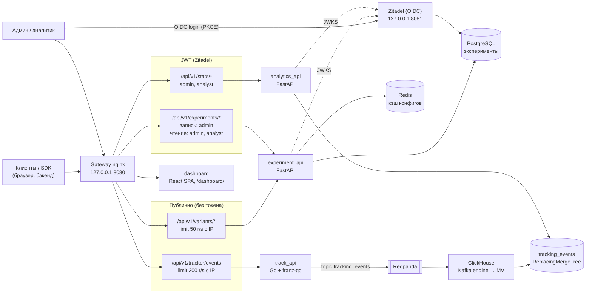

<div align="center">
  <h1>SynaqCore</h1>
  <p><b>Self-hosted платформа серверных A/B/n-экспериментов:<br>
  детерминированное распределение без обращений к БД, приём событий через Kafka (Redpanda)<br>
  и статистика на ClickHouse</b></p>

  <!-- Badges -->
  <p>
    
    
    
    
    
    
    
    
    
  </p>

  <p>
    
  </p>
</div>

---

> **Статус.** Портфолио / pet-project. Стек поднимается одной командой и готов к self-hosted пилоту
> на одном сервере. До продакшена не хватает TLS, полноценного A/B/n-анализа (сейчас статистика
> сравнивает контроль с одним вариантом) и мониторинга — см. [ограничения](#ограничения-и-планы).

## Содержание

- [Архитектура](#архитектура)
- [Демо за 5 минут](#демо-за-5-минут)
- [Ключевые инженерные решения](#ключевые-инженерные-решения)
- [main vs lite](#main-vs-lite)
- [Почему не GrowthBook/PostHog?](#почему-не-growthbookposthog)
- [Технологический стек](#технологический-стек)
- [Подробный запуск и конфигурация](#подробный-запуск-и-конфигурация)
- [Аутентификация и роли](#аутентификация-и-роли)
- [API](#api)
- [Интеграция и SDK](#интеграция-и-sdk)
- [Аналитика и статистика](#аналитика-и-статистика)
- [Схема данных ClickHouse](#схема-данных-clickhouse)
- [Структура репозитория](#структура-репозитория)
- [Тесты и CI](#тесты-и-ci)
- [Ограничения и планы](#ограничения-и-планы)
- [Документация](#документация)

---

## Архитектура

Пути чтения (выдача варианта) и записи (приём событий) разделены: выдача вариантов — Python + Redis + Postgres,
приём событий — Go → Redpanda → ClickHouse без промежуточных воркеров, тяжёлая аналитика — отдельный сервис.



| Путь | Сервис | Доступ |
|---|---|---|
| `/api/v1/variants/` (`/{name}`, `/batch`, `/active`, `/config/{name}`, `/eval-configs`) | `experiment_api` | публично, `limit_req` 50 r/s с IP (burst 100) → `429` |
| `/api/v1/experiments/` | `experiment_api` | JWT: `POST` / `PATCH` / `DELETE` — `admin`; `GET` — `admin` или `analyst` |
| `/api/v1/tracker/events` | `track_api` (Go) | публично, `limit_req` 200 r/s с IP (burst 400) → `429` |
| `/api/v1/stats/` | `analytics_api` | JWT: `admin` или `analyst` |
| `/dashboard/` (`/admin` → 302) | `dashboard` | вход через Zitadel |
| `127.0.0.1:8081` | Zitadel | отдельный server-блок gateway (корневые пути Zitadel конфликтуют с путями платформы) |

Наружу публикуется только gateway, и только на `127.0.0.1`. Postgres, Redis, Redpanda и ClickHouse доступны лишь во внутренней сети `ab_testing_net`.

---

## Демо за 5 минут

Нужны Docker Engine 24+ с Compose v2, `make`, `curl`, `jq` и Python 3.11+ с `httpx` (есть в `./venv`, если он создан).

> **Если стек уже запускался раньше.** Init-скрипты ClickHouse выполняются только на пустом томе, поэтому существующий
> том сохраняет старую схему Kafka-engine (до исправления `02-kafka.sql` очередь и MV на ClickHouse 24.8 вообще не
> создавались — события оседают в Redpanda, а `/stats` пуст). Перед демо выполните `make ch-reset` (пересоздаёт
> `tracking_events_queue` и `tracking_events_mv` из `02-kafka.sql`, данные `tracking_events` не трогает) или
> `docker compose down -v` (удаляет **все** тома, включая Postgres и Zitadel).

```bash
git clone https://github.com/Kebiproger/synaqcore.git && cd synaqcore

# 1. Окружение. В infra/.env.infra обязательно задать переменные ZITADEL_* —
#    список и требования в CLAUDE.md (раздел Commands) и ниже, в «Подробном запуске».
cp apps/.env.apps.example apps/.env.apps
cp infra/.env.infra.example infra/.env.infra

# 2. Весь стек: инфраструктура, сервисы, gateway, Zitadel и его bootstrap
make up

# 3. JWT сервисного аккаунта synaq-automation (роль admin) в SYNAQ_TOKEN
eval "$(make -s token)"

# 4. Симуляция A/B-теста: 5000 синтетических пользователей, treatment +15% к конверсии
make demo
# с параметрами: make demo DEMO_ARGS="--users 1000 --seed 42 --uplift 0.2"
```

Что делает `make demo` (`sdk/demo_simulator.py`, все флаги — `--help`):

1. проверяет шлюз;
2. создаёт (или включает) эксперимент `demo_checkout_button` с вариантами `control` / `treatment` 50/50;
3. распределяет пользователей по вариантам. По умолчанию `--allocation local`: расчёт в памяти через `sdk/python`
   после сверки с сервером на выборке (чтобы не упираться в лимит nginx); `--allocation remote` — запрос к
   `/api/v1/variants/` на каждого пользователя;
4. отправляет события в трекер (`--concurrency`, по умолчанию 50 параллельных запросов);
5. ждёт, пока данные дойдут до ClickHouse (`--stats-timeout`, по умолчанию 60 с), и печатает отчёт `/api/v1/stats/`.

Ожидаемый вывод (сокращённо, числа зависят от seed):

```text
========================================================================
SynaqCore demo: эксперимент 'demo_checkout_button', 5000 пользователей, ...
========================================================================
[1/5] Проверка шлюза
[2/5] Эксперимент
[3/5] Распределение по вариантам (режим local)
  Локальный расчёт (sdk/python) совпал с сервером на ... пользователях
[4/5] Отправка событий в трекер
[5/5] Ожидание данных в ClickHouse (до 60 с)

Отчёт /api/v1/stats/demo_checkout_button ...
Вариант        Польз.  Конверсий  Конверсия   | отправлено: польз./конв.
...
Статистика
  Относительный uplift:       +...%
  95% ДИ uplift:              [...]
  p-value (z-тест):           ...
  P(treatment > control):     ...%
Рекомендации
  * ...
```

Затем откройте дашборд: **http://localhost:8080/dashboard/** — логин `<ZITADEL_FIRSTINSTANCE_ORG_HUMAN_USERNAME>@synaqcore.localhost`
и пароль из `infra/.env.infra` (при первом входе Zitadel попросит его сменить).

<!-- TODO: добавить скриншоты в docs/img/ и раскомментировать:


-->

Остановить стек: `make down`. Все команды: `make help`.

Если `/stats` так и не показал данных: проверьте, что очередь и MV существуют
(`docker compose exec clickhouse clickhouse-client -q "SHOW TABLES"` — должны быть `tracking_events_queue` и
`tracking_events_mv`), и при необходимости выполните `make ch-reset`.

---

## Ключевые инженерные решения

- **Детерминированное stateless-распределение.** `bucket = int(SHA-256("{user_id}:{experiment}"), 16) % 10000`;
  варианты перебираются в **алфавитном порядке**, выбирается первый, для которого `bucket * total < cumulative * 10000`
  (целочисленная арифметика, без float). *Зачем:* назначения не хранятся в БД — выдача варианта не пишет в базу и
  масштабируется горизонтально, а серверные SDK (`sdk/python`, `sdk/go`) считают вариант локально и получают тот же
  ответ. *Почему по алфавиту:* конфиг приходит то из Redis (порядок ключей из запроса), то из Postgres JSONB,
  который порядок ключей не сохраняет (сортирует по длине, затем по байтам). При обходе в порядке словаря
  `{"treatment": 50, "control": 50}` после истечения TTL кэша менял вариант у части пользователей.
  Сортировка делает порядок каноническим; совпадение сервера и SDK закреплено тестами и golden-векторами.
- **Zero-worker ingestion.** Go-трекер публикует JSON в топик `tracking_events`, а ClickHouse сам вычитывает его
  через `ENGINE = Kafka` и materialized view в рабочую таблицу. *Зачем:* нет отдельного консьюмера, который надо
  деплоить, масштабировать и мониторить; Redpanda остаётся долговременным буфером, если ClickHouse недоступен.
  Битые сообщения не останавливают чтение топика (`kafka_handle_error_mode = 'stream'`, MV отбрасывает строки с `_error`).
- **Дедупликация по `event_id`.** `ReplacingMergeTree(timestamp)` с `ORDER BY (event_name, user_id, event_id, toDate(timestamp))`;
  если клиент не передал `event_id`, его генерирует трекер (а JS SDK — ещё раньше, на клиенте, чтобы ретраи из браузера
  несли один и тот же id). Серверным клиентам стоит передавать свой идемпотентный ключ (например, id заказа):
  сгенерированный трекером id у повторной отправки будет другим. *Зачем:* доставка at-least-once (ретраи браузера, повторы
  продюсера) даёт дубликаты. Схлопывание происходит при фоновых слияниях, поэтому метрики дополнительно считаются
  через `countDistinct(user_id)` и на конверсию дубликаты не влияют.
- **Аналитика — отдельный сервис (bulkhead).** `analytics_api` обслуживает `/api/v1/stats/` и ходит только в
  ClickHouse; Монте-Карло выполняется в `asyncio.to_thread`. *Зачем:* тяжёлый запрос аналитика не может съесть CPU
  и пул соединений сервиса, который отдаёт варианты пользователям.
- **Redis circuit breaker.** Таймауты 0.3 с, один повтор; после ошибки Redis пропускается 5 с и конфиг читается
  из Postgres (с повторным кэшированием). *Зачем:* падение кэша замедляет выдачу, но не роняет её. Чтобы это
  нельзя было превратить в DoS на Postgres, публичный `/api/v1/variants/` ограничен в nginx.
- **Fail-closed JWT.** Только RS256, ключи из JWKS Zitadel, проверка `iss`, `aud` (= project_id), `exp` и
  обязательного `jti` (ID token как bearer не проходит); роли — только из проектного claim. Если OIDC не настроен
  или JWKS недоступен — `503`, а не пропуск без проверки.
- **Backpressure в трекере.** Очередь продюсера ограничена (по умолчанию 10 000 сообщений); если брокер не
  успевает, трекер сразу отвечает `503` с `Retry-After: 1`, а не копит события в памяти до OOM.
- **Окно timestamp.** Трекер принимает события не старше 7 дней и не дальше 5 минут в будущем (миллисекунды Unix;
  `0` — подставить серверное время). *Зачем:* иначе анонимный клиент мог прислать события за сотни месяцев:
  вставка задевала больше `max_partitions_per_insert_block` партиций (`PARTITION BY toYYYYMM`), Kafka-движок
  бесконечно повторял «ядовитый» батч, и приём вставал для всех.
- **Лимиты на входе.** nginx: `limit_req` на `/api/v1/variants/` (50 r/s с IP) и `/api/v1/tracker/` (200 r/s с IP).
  Трекер: тело ≤ 64 КБ (`413`), строковые поля ≤ 256 символов и `event_data` ≤ 16 КБ (`400`).
- **Валидация всего, что попадает в SQL.** ClickHouse-запросы собираются строкой, поэтому `goal_event`, шаги воронки
  и guardrail-события проверяются regex, сегменты — regex + экранирование (не больше 10), `metric_field` — по
  whitelist, `limit` — как целое. Тексты ошибок ClickHouse пишутся в лог и не возвращаются клиенту.

---

## main vs lite

| | **main** (эта ветка) | **lite** (в разработке, ветка `lite` ещё не создана) |
|---|---|---|
| Назначение | «enterprise»-вариант, демонстрация распределённой архитектуры | минимальный self-hosted для стартапа |
| Выдача вариантов и admin API | Python `experiment_api` + Redis | один Go-сервис: варианты + трекер + admin API |
| Конфиги экспериментов | Redis → Postgres | в памяти процесса; обновление по Postgres `LISTEN/NOTIFY` + полная перезагрузка раз в 30 с |
| Приём событий | Go → Redpanda → ClickHouse Kafka engine | Go пишет напрямую в ClickHouse батчами (`EVENT_SINK=clickhouse`, уже реализовано в `apps/track_api_go/internal/sink/clickhouse`) |
| Postgres | общий для экспериментов и Zitadel | отдельные инстансы для бизнес-данных и для Zitadel |
| Redis / Kafka | есть | нет |
| Аналитика | `analytics_api` (Python) | остаётся Python |
| Целевая площадка | несколько сервисов, горизонтальное масштабирование | 1 VPS, 2 vCPU / 4 GB, ~1–2 тыс. событий/с |

**Честный компромисс lite:** без Kafka нет долговременного буфера. Пока ClickHouse недоступен, события ждут в
ограниченном буфере в памяти трекера (с ретраями); когда он заполнится, клиенты получают `503` + `Retry-After`,
а при перезапуске процесса содержимое буфера теряется. Для A/B-аналитики это приемлемо (SDK повторяют отправку,
потеря доли процента событий не меняет вывод), для биллинга — нет.

---

## Почему не GrowthBook/PostHog?

GrowthBook, PostHog, Statsig и Unleash заметно зрелее: больше интеграций, готовые UI для фича-флагов и
таргетинга, проверенные статистические движки. SynaqCore их не заменяет. Зачем он существует:

- **Учебная и портфолио-цель.** Пройти весь путь самому: детерминированный бакетинг, ingestion-пайплайн,
  ClickHouse, OIDC, статистика — и уметь объяснить каждое решение.
- **Серверное детерминированное распределение без обращения к БД на запрос.** Вариант вычисляется из хеша,
  серверные SDK считают его локально по кэшу конфигов (`/api/v1/variants/eval-configs`, опрос раз в 30 с).
- **Self-hosted с полным контролем над статистикой.** Движок (z-тест, интервалы Уилсона, байесовский
  Монте-Карло, рекомендации) написан на чистом Python без scipy и целиком читается и меняется.
- **Минимальный footprint в lite.** Цель — один Go-бинарь + Postgres + ClickHouse на одном небольшом VPS.

---

## Технологический стек

| Компонент | Технология | Роль | Порт |
|-----------|-----------|------|------|
| **Gateway** | nginx | Единая точка входа, маршрутизация по префиксу, rate limit, раздача `/sdk/` | `127.0.0.1:8080` (хост) |
| **Track API** | Go, Gin, franz-go | Приём событий, валидация, публикация в Redpanda | `8000` |
| **Брокер** | Redpanda v26 (Kafka API) | Топик `tracking_events` (4 партиции, ключ — `user_id`) | `9092` |
| **OLAP** | ClickHouse 24.8 | Kafka engine + MV, хранение событий, агрегации | `8123`, `9000` |
| **Experiment API** | Python 3.11, FastAPI | CRUD экспериментов, выдача вариантов | `8000` |
| **Analytics API** | Python 3.11, FastAPI | Статистика экспериментов (изолирована от выдачи вариантов) | `8000` |
| **Dashboard** | React, Vite, Tailwind | SPA управления экспериментами и просмотра результатов | `/dashboard/` |
| **IdP** | Zitadel | OIDC/OAuth2: вход в дашборд, JWT для API, роли `admin` / `analyst` | `127.0.0.1:8081` (хост) |
| **Metadata DB** | PostgreSQL 16 | Эксперименты и веса вариантов; отдельная БД `zitadel` | `5432` |
| **Cache** | Redis 7.2 | Кэш конфигов экспериментов | `6379` |

---

## Подробный запуск и конфигурация

В `infra/.env.infra` обязательно задайте ключи Zitadel (без них `docker compose` не стартует):

| Ключ | Значение |
|------|----------|
| `ZITADEL_MASTERKEY` | Случайная строка **ровно из 32 символов** (`openssl rand -hex 16`). Шифрует данные Zitadel — после первой инициализации её нельзя изменить. |
| `ZITADEL_DATABASE_POSTGRES_USER_PASSWORD` | Пароль пользователя `zitadel` в PostgreSQL (создаётся Zitadel автоматически). |
| `ZITADEL_DATABASE_POSTGRES_ADMIN_USERNAME` | То же значение, что `POSTGRES_USER`. |
| `ZITADEL_DATABASE_POSTGRES_ADMIN_PASSWORD` | То же значение, что `POSTGRES_PASSWORD`. |
| `ZITADEL_FIRSTINSTANCE_ORG_HUMAN_USERNAME` | Логин первого администратора (например, `zitadel-admin`). |
| `ZITADEL_FIRSTINSTANCE_ORG_HUMAN_PASSWORD` | Начальный пароль администратора (будет сменён при первом входе). |
| `ZITADEL_BOOTSTRAP_PAT_EXPIRATION` | Срок действия bootstrap-PAT (ISO-8601, ≈ сейчас + 30 дней): `date -u -d '+30 days' +%Y-%m-%dT00:00:00Z`. Учитывается только при самой первой инициализации Zitadel. |

Необязательные: `ZITADEL_APP_DEVMODE` (по умолчанию `true` — разрешает `http://` redirect URI; для HTTPS — `false`),
`GATEWAY_PORT` / `ZITADEL_PORT` (по умолчанию `8080` / `8081`; из них же строятся redirect URI, issuer и `ZITADEL_EXTERNALPORT`).

> **Не создавайте `.env` в корне репозитория.** Корневой `.env` имеет приоритет над `infra/.env.infra` при интерполяции
> `${...}` в compose и молча переопределит `POSTGRES_*`. Поэтому для Zitadel используются отдельные имена
> `ZITADEL_DATABASE_POSTGRES_ADMIN_*`.

Корневой `docker-compose.yml` подключает (`include`) `infra/docker-compose.infra.yml`, `apps/docker-compose.apps.yml`
и `nginx/docker-compose.yml`. Python-сервисы монтируют исходники и работают с `uvicorn --reload`; Go-трекер и дашборд
требуют `--build`. После пересоздания любого контейнера приложения выполните `docker compose restart gateway`:
nginx резолвит имена upstream только при старте.

Zitadel стартует в три шага: `zitadel-dbinit` (`zitadel init`, единственный контейнер с учёткой суперпользователя
PostgreSQL) → `zitadel-setup` (миграции, первый инстанс, bootstrap-PAT) → `zitadel` (`zitadel start`). Затем одноразовый
`zitadel-init` (`infra/zitadel/bootstrap.sh`) создаёт проект, роли `admin` / `analyst`, OIDC-приложение дашборда и
сервисный аккаунт `synaq-automation`. Публичная OIDC-конфигурация пишется в `infra/zitadel/public/oidc.json`, секрет
сервисного аккаунта — в `infra/zitadel/secrets/automation.json` (не коммитится). После успешного bootstrap PAT с правами
IAM owner (`secrets/bootstrap.pat`) удаляется; повторные запуски без PAT ничего не меняют и завершаются с кодом 0.
Чтобы позже применить изменённые настройки OIDC-приложения, создайте в консоли Zitadel короткоживущий PAT для
`zitadel-bootstrap`, сохраните его в `infra/zitadel/secrets/bootstrap.pat` (`chmod 600`) и перезапустите `zitadel-init`.

Интерфейсы:
- **Дашборд:** http://localhost:8080/dashboard/ (старый адрес `/admin` перенаправляет сюда).
- **Консоль Zitadel:** http://localhost:8081/ui/console (пользователи, роли, приложения).

> **Обновление существующего тома ClickHouse.** Скрипты из `infra/clickhouse/init/` выполняются только на пустом томе.
> Если том создан до исправления `02-kafka.sql` (раньше Kafka-таблица объявлялась с `DEFAULT` и ClickHouse 24.8 её
> не создавал), выполните `make ch-reset` — он пересоздаёт `tracking_events_queue` и `tracking_events_mv` из `02-kafka.sql`.
> Альтернатива — `docker compose down -v` (удалит все тома).

---

## Аутентификация и роли

Управление экспериментами и статистика защищены JWT (OIDC, IdP — Zitadel). Выдача вариантов (`/api/v1/variants/...`)
и трекинг (`/api/v1/tracker/events`) публичны.

| Роль | Права |
|------|-------|
| `admin` | Создание, изменение (`PATCH`), остановка и удаление экспериментов; список и статистика. |
| `analyst` | Только чтение: список экспериментов и статистика. |

Первый администратор и сервисный аккаунт `synaq-automation` получают роль `admin` автоматически. Выдать роль `analyst`:
консоль Zitadel → **Projects** → `synaqcore` → **Authorizations** → **New**. Роль появится в токене после повторного входа.

Токен для API и скриптов (OAuth2 `client_credentials`, нужны `curl` и `jq`):
```bash
eval "$(make -s token)"            # или: export SYNAQ_TOKEN="$(scripts/get_token.sh)"
curl -H "Authorization: Bearer $SYNAQ_TOKEN" http://localhost:8080/api/v1/experiments/
```

---

## API

### Выдача варианта (публично)
```bash
curl "http://localhost:8080/api/v1/variants/landing_button_test?user_id=usr_777"
```
```json
{"experiment_name": "landing_button_test", "user_id": "usr_777", "variant": "B"}
```
Для неизвестного или выключенного эксперимента возвращается `"variant": "control"`. Конфиг рендеринга вариантов —
`GET /api/v1/variants/config/{name}`.

Другие публичные эндпоинты: `POST /api/v1/variants/batch` (`{"user_id": "...", "experiments": [...]}`, до 50 экспериментов),
`GET /api/v1/variants/active` (активные эксперименты и имена вариантов), `GET /api/v1/variants/eval-configs`
(веса активных экспериментов для локального расчёта в серверных SDK).

### Создание эксперимента (`admin`)
```bash
curl -X POST "http://localhost:8080/api/v1/experiments/" \
  -H "Authorization: Bearer $SYNAQ_TOKEN" \
  -H "Content-Type: application/json" \
  -d '{"name": "landing_button_test", "variants": {"A": 50, "B": 50}}'
```
Частичное обновление — `PATCH /api/v1/experiments/{name}`. Менять варианты у активного эксперимента нельзя (`409 Conflict`,
иначе поменялось бы распределение пользователей): сначала остановите его (`{"is_active": false}`).

### Отправка события (публично)
```bash
curl -X POST "http://localhost:8080/api/v1/tracker/events" \
  -H "Content-Type: application/json" \
  -d '{
    "event_id": "evt_01",
    "user_id": "usr_777",
    "event_name": "cta_click",
    "experiment_name": "landing_button_test",
    "variant": "B",
    "event_data": "{\"screen\":\"main\"}"
  }'
```

| Код | Когда |
|---|---|
| `200 {"status":"OK"}` | событие принято в очередь продюсера |
| `400` | невалидный JSON, нет `user_id` / `event_name`, поле длиннее 256 символов, `event_data` > 16 КБ, `timestamp` вне окна [сейчас − 7 дней, сейчас + 5 минут] |
| `413` | тело запроса больше 64 КБ |
| `429` | превышен лимит nginx (200 r/s с IP, burst 400) |
| `503` + `Retry-After: 1` | очередь продюсера переполнена или брокер недоступен — повторите позже |

`timestamp` — миллисекунды Unix, необязателен (по умолчанию серверное время). `event_id` — ключ дедупликации; если его нет,
трекер сгенерирует свой, но для ретраев с бэкенда лучше передавать стабильный ключ.

### Статистика (`admin` или `analyst`, сервис `analytics_api`)
```bash
curl "http://localhost:8080/api/v1/stats/landing_button_test?goal_event=cta_click&method=both" \
  -H "Authorization: Bearer $SYNAQ_TOKEN"
curl "http://localhost:8080/api/v1/stats/landing_button_test/basic" -H "Authorization: Bearer $SYNAQ_TOKEN"
```
Параметры полного отчёта: `method` (`frequentist` | `bayesian` | `both`), `goal_event` (по умолчанию `purchase`),
`segments` (по умолчанию `platform,user_tenure`), `hide`, `monthly_traffic`.

---

## Интеграция и SDK

- **[Руководство по интеграции](docs/INTEGRATION_GUIDE.md)** — сетевая изоляция, подключение через корпоративный nginx,
  клиентские и серверные примеры, M2M-автоматизация.
- **JavaScript / TypeScript SDK** ([`sdk/README.md`](sdk/README.md)): zero-dependency [`sdk/synaq.js`](sdk/synaq.js) с типами
  [`sdk/synaq.d.ts`](sdk/synaq.d.ts) и [`sdk/package.json`](sdk/package.json) для сборки пакета `@synaq/client`; кэш вариантов
  в памяти и `localStorage`, `getVariantsBatch(...)`, буферизация событий, `navigator.sendBeacon` с fallback на
  `fetch(..., { keepalive: true })`, автогенерация `event_id`. Gateway раздаёт файл по `/sdk/synaq.js`.
- **React:** [`sdk/react.jsx`](sdk/react.jsx) — `<SynaqProvider>` и хук `useVariant`.
- **Серверные SDK с локальным расчётом:** [`sdk/python`](sdk/python) и [`sdk/go`](sdk/go) — опрашивают
  `/api/v1/variants/eval-configs` (по умолчанию раз в 30 с) и считают вариант в памяти тем же алгоритмом, что и сервер.
- **Корпоративный nginx:** [`nginx/company-edge-integration.example.conf`](nginx/company-edge-integration.example.conf) —
  поддомен или префикс пути, Cloudflare real IP, закрытие `/dashboard/` через VPN / Cloudflare Access.

---

## Аналитика и статистика

```
                     ClickHouse (агрегаты по вариантам)
                                  │
                                  ▼
                   ┌──────────────────────────────┐
                   │    StatisticalAnalyzer       │
                   └──────┬────────────────┬──────┘
             Частотный    │                │    Байесовский
          ┌───────────────▼─────┐   ┌──────▼─────────────────────────┐
          │ Двусторонний z-тест │   │ Монте-Карло: сэмплирование из  │
          │ для долей, p-value  │   │ Beta-апостериорных (50 000)    │
          │ Интервалы Уилсона   │   │ P(variant > control)           │
          │ ДИ разницы и uplift │   │ Expected loss, credible int.   │
          └───────────────┬─────┘   └──────┬─────────────────────────┘
                          └───────┬────────┘
                                  ▼
          Бизнес-метрики (выручка, ARPU, guardrails, MDE), сегменты, воронка
                                  │
                                  ▼
                   Рекомендации на русском языке
```

Движок (`apps/analytics_api/src/services/analysis/`) написан на `math` / `random` без scipy. Ограничение: сравниваются
контроль (`A` или `control`) и **один** другой вариант; для A/B/n нужны попарные сравнения с контролем и поправка на
множественные проверки (в планах).

---

## Схема данных ClickHouse

DDL применяется автоматически на пустом томе из `infra/clickhouse/init/`:

- [`01-tables.sql`](infra/clickhouse/init/01-tables.sql) — таблица `tracking_events` (`ReplacingMergeTree(timestamp)`,
  `PARTITION BY toYYYYMM(timestamp)`, `ORDER BY (event_name, user_id, event_id, toDate(timestamp))`, колонки
  `DEFAULT ''` вместо `Nullable`);
- [`02-kafka.sql`](infra/clickhouse/init/02-kafka.sql) — `tracking_events_queue` (`ENGINE = Kafka`, без `DEFAULT`,
  `kafka_handle_error_mode = 'stream'`) и `tracking_events_mv` (`WHERE length(_error) = 0`). Нужен только в режиме с Kafka.

Подробнее: [docs/clickhouse-kafka/README.md](docs/clickhouse-kafka/README.md). При изменении формата события синхронно
меняются Go-хендлер, обе таблицы, MV и SDK.

---

## Структура репозитория

```
synaqcore/
├── apps/
│   ├── experiment_api/          # FastAPI: CRUD экспериментов и выдача вариантов
│   │   └── src/
│   │       ├── api/v1/          # admin.py (эксперименты), client.py (варианты)
│   │       ├── core/            # конфигурация, БД, JWT-аутентификация
│   │       └── services/        # allocation.py, cache.py, репозиторий
│   ├── analytics_api/           # FastAPI: /api/v1/stats, ClickHouse-агрегатор, движок статистики
│   ├── dashboard/               # SPA (React + Vite + Tailwind)
│   ├── track_api_go/            # Go-трекер событий
│   │   ├── cmd/api/main.go      # точка входа, выбор приёмника (EVENT_SINK)
│   │   ├── internal/track/      # HTTP-хендлер и валидация
│   │   ├── internal/kafka/      # продюсер franz-go с ограниченной очередью
│   │   └── internal/sink/       # интерфейс приёмника и ClickHouse-приёмник (lite)
│   ├── docker-compose.apps.yml
│   └── .env.apps.example
├── infra/
│   ├── clickhouse/init/         # 01-tables.sql, 02-kafka.sql
│   ├── zitadel/                 # bootstrap.sh (zitadel-init), public/, secrets/
│   ├── docker-compose.infra.yml # Redpanda, ClickHouse, Redis, PostgreSQL, Zitadel
│   └── .env.infra.example
├── nginx/                       # nginx.conf шлюза, пример для корпоративного edge
├── scripts/get_token.sh         # JWT сервисного аккаунта
├── sdk/                         # JS/TS SDK, React, sdk/python, sdk/go, demo_simulator.py
├── tests/                       # pytest-тесты и нагрузочный профиль (tests/load)
├── docs/                        # архитектура, ADR, планы
├── Makefile                     # up / down / token / demo / ch-reset / test / lint / go-test
└── docker-compose.yml           # include всех compose-файлов
```

---

## Тесты и CI

```bash
make test      # pytest: 402 теста (allocation, auth, схемы, Redis-fallback, SDK, аналитика, роутер /stats)
make lint      # ruff check apps tests sdk
make go-test   # go test для apps/track_api_go (хендлер, Kafka-продюсер, ClickHouse-приёмник) и sdk/go (golden-векторы)
```

`./venv/bin` скрипты имеют сломанный shebang, поэтому `make` вызывает инструменты через `python -m`.

GitHub Actions (`.github/workflows/ci.yml`): ruff + pytest, gofmt + go vet + go test для обоих Go-модулей (и go build трекера),
typecheck и сборка дашборда, сборка Docker-образов; actions закреплены по SHA, обновления — Dependabot.

Нагрузочный тест (Locust):
```bash
eval "$(make -s token)"   # чтобы locust сам создал тестовый эксперимент
locust -f tests/load/locustfile.py --host http://localhost:8080
```
> С одной машины упрётесь в `limit_req` nginx (`/api/v1/variants/` — 50 r/s с IP, трекер — 200 r/s): ответы `429`.
> Учитывайте это или временно ослабьте лимиты в `nginx/nginx.conf`.

---

## Ограничения и планы

- Нет TLS: gateway и Zitadel работают по HTTP (`ZITADEL_EXTERNALSECURE=false`). Для продакшена нужны HTTPS и внешний домен.
- Статистика сравнивает контроль с одним вариантом; A/B/n с поправкой на множественные проверки — в планах.
- `src/core/auth.py` продублирован в `experiment_api` и `analytics_api`.
- Нет Prometheus-метрик и публичного Swagger через gateway.
- Lite-вариант (см. [main vs lite](#main-vs-lite)) — в разработке.

Подробно: [docs/plan.md](docs/plan.md), текущий статус — [docs/SESSION_CONTEXT.md](docs/SESSION_CONTEXT.md).

---

## Документация

- [docs/SYSTEM_DESIGN.md](docs/SYSTEM_DESIGN.md) — архитектура
- [docs/INTEGRATION_GUIDE.md](docs/INTEGRATION_GUIDE.md) — интеграция
- [docs/clickhouse-kafka/README.md](docs/clickhouse-kafka/README.md) — пайплайн Kafka → ClickHouse
- [docs/adr/0001-kafka-vs-rabbitmq.md](docs/adr/0001-kafka-vs-rabbitmq.md) — ADR: выбор Kafka (Redpanda)
- [docs/plan.md](docs/plan.md) — дорожная карта

## Лицензия

Планируется MIT; файл `LICENSE` пока не добавлен в репозиторий.
