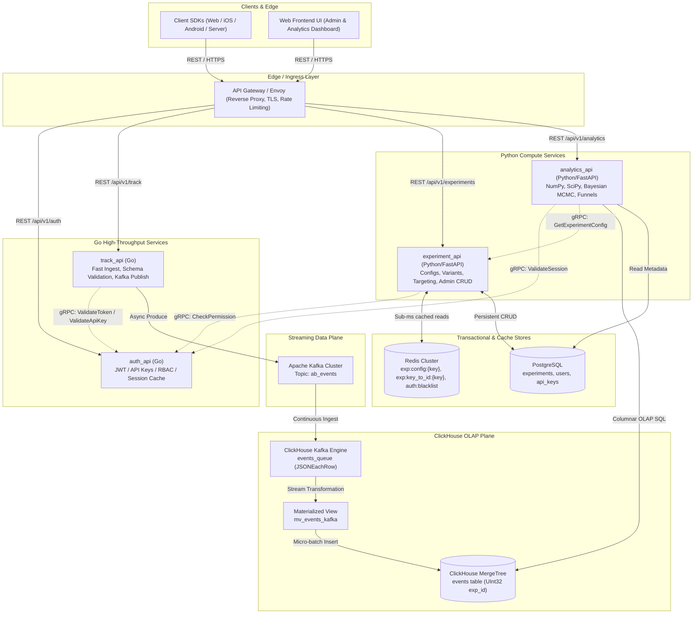
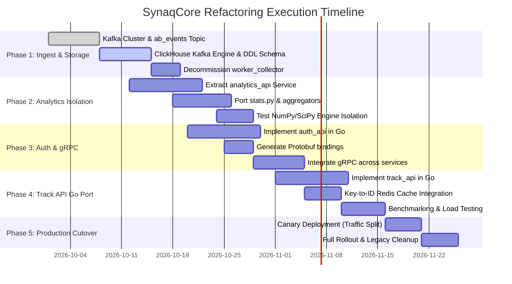

# SynaqCore Architecture Refactoring Specification

**Document Version:** 2.1.0  
**Status:** Approved for Implementation  
**Target Architecture:** Distributed Event-Driven & Microservices Topology  
**Last Updated:** October 2026  

---

## 1. Executive Summary & Architectural Motivation

SynaqCore is an enterprise-grade experimentation (A/B testing, multi-armed bandits, feature flagging) and analytics platform. As event volumes scale to hundreds of thousands of events per second (EPS) and experimentation analysis requires sophisticated Bayesian and frequentist statistical modeling, the initial architectural tier reaches critical scalability, latency, and maintainability ceilings.

### 1.1 Current Architectural Bottlenecks
1. **Collector Worker Fragility (`worker_collector`)**:
   - Python-based consumers subscribing to RabbitMQ/Kafka suffer from Garbage Collection pauses, memory leaks, and CPU overhead under peak bursts.
   - Managing manual in-memory buffers, batch flushes, retries, and offset commits creates chronic consumer lag and out-of-memory (OOM) risks.
2. **Coupled Compute in `experiment_api`**:
   - Heavy scientific workloads (`clickhouse_aggregator.py`, NumPy/SciPy statistical computations, bootstrap resampling, Bayesian MCMC simulations, funnel calculations) run within the same service and process space as ultra-low-latency variant evaluation (`/variant`) and critical admin CRUD operations.
   - An expensive analytical query or computation spikes CPU/RAM and degrades variant evaluation latency SLAs.
3. **Language & Runtime Mismatch**:
   - High-throughput ingestion (`track_api`) and authentication token checks (`auth`) are I/O and concurrency-bound operations where Go delivers superior throughput, predictable sub-millisecond p99 latencies, and minimal memory footprints compared to Python interpreters.
4. **Message Broker Scalability**:
   - AMQP/RabbitMQ queue architectures experience heavy overhead under massive horizontal fan-outs, partitioned ordering requirements, and gigabyte-per-second ingestion rates compared to distributed append-only commit logs (Apache Kafka).

---

## 2. Target Architecture Overview

The refactored architecture transitions SynaqCore into a high-performance polyglot microservices system. High-throughput edge ingestion and authentication services are implemented in **Go**, while scientific statistical modeling and metadata management reside in specialized **Python** microservices. ClickHouse native streaming ingestion eliminates custom collector processes entirely.



---

## 3. Experiment Identification Architecture (`id` vs `key` vs `name`)

To eliminate ambiguity across API contracts, SDK runtime performance, database indexing, and analytical data integrity, SynaqCore enforces a strict **3-Tier Identification Model**:

```
+----------------------------------------------------------------------------------------------------+
|                                    3-TIER IDENTIFICATION MODEL                                      |
+----------------------------------------------------------------------------------------------------+
| Tier 1: id       | Immutable Surrogate Primary Key  | BIGINT / BIGSERIAL (Postgres), UInt32 (ClickHouse)   |
| Tier 2: key      | Machine-Readable Unique Slug     | VARCHAR(64) UNIQUE NOT NULL (snake_case)           |
| Tier 3: name     | Human-Readable Display Title     | VARCHAR(255) NOT NULL (Mutable Display Label)      |
+----------------------------------------------------------------------------------------------------+
```

### 3.1 The 3-Tier Identification Definitions

1. **`id` (`BIGINT / BIGSERIAL` in PostgreSQL; `UInt32` in ClickHouse)**:
   - **Role**: Surrogate, immutable internal identifier.
   - **Usage**: Primary key in PostgreSQL, relational foreign keys, internal cache pointers, and the primary ordering key in ClickHouse OLAP tables.
   - **Performance**: ClickHouse primary key compression and filtering on integer columns (`UInt32`, 4 bytes) is exponentially faster and consumes significantly less RAM/disk compared to variable-length strings or UUIDs when sorting billions of event rows.

2. **`key` (`VARCHAR(64) UNIQUE NOT NULL`, e.g., `checkout_button_color`, `search_algo_v2`)**:
   - **Role**: Machine-readable, developer-friendly slug constrained to lowercase alphanumeric characters and underscores (`^[a-z0-9_]{3,64}$`).
   - **Usage**:
     - Client and mobile SDK calls (`client.get_variant("checkout_button_color")`).
     - REST API routing (`GET /api/v1/experiments/config/{key}`).
     - Redis cache key namespaces (`exp:config:{key}`).
     - Deterministic hash bucketing salt: `hash(user_id + ":" + experiment_key) % 100`.

3. **`name` / `title` (`VARCHAR(255) NOT NULL`, e.g., `Checkout Button Color Test - Q4 Mobile Redesign`)**:
   - **Role**: Human-readable descriptive title for the admin dashboard, executive reports, and experiment lists.
   - **Usage**: Exclusively for display purposes in the UI.
   - **Immutability Policy**: Can be renamed at any time by product managers or analysts with **zero impact** on client SDKs, bucketing logic, Redis caches, or historical ClickHouse analytics.

---

### 3.2 Critical Engineering Rationale: Why `key` MUST Be Strictly Unique

Allowing non-unique or duplicate experiment keys causes severe architectural breakdowns across all layers:

#### 1. Ambiguity in API Resolution (`GET /config/{key}` and `/variant/{key}`)
SDKs fetch experiment configurations by key. If duplicate keys exist across departments or historical archives:
- The API gateway or service cannot deterministically identify which experiment configuration to serve.
- Race conditions emerge where SDKs intermittently load different experiment payloads, resulting in erratic frontend rendering and broken user experiences.

#### 2. Cache Invalidation and Overwrite Disasters in Redis (`exp:config:{key}`)
Active experiment configurations are aggressively cached in Redis under the namespace `exp:config:{key}`.
- If two experiments share the same key, updating Experiment B will silently overwrite the cached configuration of Experiment A.
- Experiment A's targeting rules, variant traffic allocations, and payloads will be corrupted in the cache without explicit database errors.

#### 3. Salt Collision in Deterministic Hashing
SynaqCore assigns users to variants deterministically using cryptographic hashing:
$$\text{bucket} = \text{MurmurHash3}(\text{user\_id} + \text{":"} + \text{experiment\_key}) \pmod{100}$$
- If two experiments share the same key, every single user will compute identical hash values for both experiments.
- Users assigned to Variant "B" in the first experiment will deterministically and unconditionally be assigned to Variant "B" in the second experiment. This eliminates statistical independence, introduces severe selection bias, and invalidates all A/B testing inferences.

#### 4. Catastrophic Data Pollution in ClickHouse Analytics
When client SDKs emit track events (`track("purchase", { experiment_key: "checkout_v2" })`), mapping this key to the wrong experiment ID pollutes the OLAP storage:
- Metrics, conversions, and revenue from two completely distinct experiments will be aggregated into a single analytical dataset.
- Statistical significance tests (p-values, Bayesian credible intervals, SRM tests) will compute invalid figures, leading to erroneous business decisions with no automated way to uncouple the entangled event stream.

---

## 4. Complete Production Database Schemas

### 4.1 PostgreSQL Production Schema

PostgreSQL serves as the system of record for experiment definitions, configurations, user credentials, and API keys.

```sql
-- Enable necessary extensions
CREATE EXTENSION IF NOT EXISTS "uuid-ossp";
CREATE EXTENSION IF NOT EXISTS "pgcrypto";

-- ---------------------------------------------------------------------
-- 1. Users Table (Core Auth for Go auth_api)
-- ---------------------------------------------------------------------
CREATE TABLE IF NOT EXISTS users (
    id UUID PRIMARY KEY DEFAULT gen_random_uuid(),
    email VARCHAR(255) UNIQUE NOT NULL,
    password_hash VARCHAR(255) NOT NULL,
    role VARCHAR(50) NOT NULL DEFAULT 'viewer' CHECK (role IN ('admin', 'editor', 'analyst', 'viewer')),
    is_active BOOLEAN NOT NULL DEFAULT TRUE,
    created_at TIMESTAMPTZ NOT NULL DEFAULT NOW(),
    updated_at TIMESTAMPTZ NOT NULL DEFAULT NOW()
);

CREATE INDEX IF NOT EXISTS idx_users_email ON users(email);
CREATE INDEX IF NOT EXISTS idx_users_active ON users(is_active) WHERE is_active = TRUE;

-- ---------------------------------------------------------------------
-- 2. API Keys Table (Programmatic Ingestion & Server SDK Authentication)
-- ---------------------------------------------------------------------
CREATE TABLE IF NOT EXISTS api_keys (
    id UUID PRIMARY KEY DEFAULT gen_random_uuid(),
    key_hash VARCHAR(64) UNIQUE NOT NULL, -- SHA-256 hex digest of the raw secret key
    name VARCHAR(100) NOT NULL,
    user_id UUID NOT NULL REFERENCES users(id) ON DELETE CASCADE,
    scopes TEXT[] NOT NULL DEFAULT '{"track:write", "config:read"}',
    is_active BOOLEAN NOT NULL DEFAULT TRUE,
    expires_at TIMESTAMPTZ,
    created_at TIMESTAMPTZ NOT NULL DEFAULT NOW(),
    last_used_at TIMESTAMPTZ
);

CREATE INDEX IF NOT EXISTS idx_api_keys_hash ON api_keys(key_hash);
CREATE INDEX IF NOT EXISTS idx_api_keys_user ON api_keys(user_id);

-- ---------------------------------------------------------------------
-- 3. Experiments Table (System of Record for All Experiment Configs)
-- ---------------------------------------------------------------------
CREATE TABLE IF NOT EXISTS experiments (
    id BIGSERIAL PRIMARY KEY,
    key VARCHAR(64) UNIQUE NOT NULL,
    name VARCHAR(255) NOT NULL,
    description TEXT,
    url VARCHAR(255),
    is_active BOOLEAN NOT NULL DEFAULT FALSE,
    variants JSONB NOT NULL,
    config JSONB NOT NULL DEFAULT '{}'::jsonb,
    created_at TIMESTAMPTZ NOT NULL DEFAULT NOW(),
    updated_at TIMESTAMPTZ NOT NULL DEFAULT NOW(),
    CONSTRAINT ck_experiment_key_format CHECK (key ~ '^[a-z0-9_]{3,64}$')
);

CREATE UNIQUE INDEX IF NOT EXISTS uq_experiments_key ON experiments(key);
CREATE INDEX IF NOT EXISTS idx_experiments_active ON experiments(is_active);
CREATE INDEX IF NOT EXISTS idx_experiments_updated ON experiments(updated_at DESC);
CREATE INDEX IF NOT EXISTS idx_experiments_variants_gin ON experiments USING gin(variants);
CREATE INDEX IF NOT EXISTS idx_experiments_config_gin ON experiments USING gin(config);

-- Trigger to auto-update updated_at timestamp
CREATE OR REPLACE FUNCTION trigger_set_timestamp()
RETURNS TRIGGER AS $$
BEGIN
  NEW.updated_at = NOW();
  RETURN NEW;
END;
$$ LANGUAGE plpgsql;

DROP TRIGGER IF EXISTS set_timestamp_experiments ON experiments;
CREATE TRIGGER set_timestamp_experiments
BEFORE UPDATE ON experiments
FOR EACH ROW
EXECUTE FUNCTION trigger_set_timestamp();

DROP TRIGGER IF EXISTS set_timestamp_users ON users;
CREATE TRIGGER set_timestamp_users
BEFORE UPDATE ON users
FOR EACH ROW
EXECUTE FUNCTION trigger_set_timestamp();
```

---

### 4.2 Redis Key Namespace Architecture

Redis Cluster provides ultra-low latency (<1ms) in-memory storage for active experiment configurations, key-to-ID mappings, and authentication token blacklists.

| Key Pattern | Data Type | Serialization | TTL / Invalidation Policy | Description & Purpose |
| :--- | :--- | :--- | :--- | :--- |
| `exp:config:{key}` | `String` | JSON string | TTL: 1 hour (Evicted immediately on experiment CRUD update) | Full active experiment payload including variant weights, targeting rules, and overrides. Read on every `/config` and `/variant` evaluation. |
| `exp:key_to_id:{key}` | `String` | Integer (`UInt32`) | TTL: 24 hours (Evicted on experiment delete/update) | High-speed mapping from string slug `key` to internal surrogate integer `id`. Used by `track_api` to inject `UInt32` into Kafka messages. |
| `auth:blacklist:{jti}` | `String` | Byte (`"1"`) | TTL: Matching JWT expiration time | Revocation store for logged-out or invalidated JWTs. Checked during token validation in `auth_api`. |
| `auth:apikey:{key_hash}` | `String` | JSON string | TTL: 15 minutes | Cached API key record (scopes, user_id, active status) to avoid PostgreSQL queries on every ingestion call. |

#### Example Redis Payloads:
```json
// Key: exp:config:checkout_button_v2
{
  "id": 1042,
  "key": "checkout_button_v2",
  "name": "Checkout Button Color Redesign",
  "is_active": true,
  "variants": [
    { "id": "control", "weight": 50, "payload": { "color": "blue" } },
    { "id": "treatment_red", "weight": 50, "payload": { "color": "red" } }
  ],
  "targeting": {
    "countries": ["US", "CA", "GB"],
    "min_app_version": "2.4.0"
  },
  "hash_salt": "checkout_button_v2"
}

// Key: exp:key_to_id:checkout_button_v2
1042

// Key: auth:blacklist:d4b3c9f2-8921-4f27-9201-cf9a74e50811
"1"
```

---

### 4.3 ClickHouse Schema (Native Kafka Engine + MergeTree)

The ingestion pipeline bypasses all custom consumer workers by using ClickHouse's native Kafka engine connected directly to a MergeTree table via a Materialized View.

```sql
CREATE DATABASE IF NOT EXISTS synaqcore;

-- ---------------------------------------------------------------------
-- 1. Kafka Queue Engine Table
-- ---------------------------------------------------------------------
-- Reads raw JSON-formatted events directly from Apache Kafka topic 'ab_events'
CREATE TABLE IF NOT EXISTS synaqcore.events_queue (
    event_id UUID,
    experiment_id UInt32,
    variant LowCardinality(String),
    user_id String,
    event_name LowCardinality(String),
    timestamp DateTime64(3, 'UTC'),
    value Float64,
    properties String,
    environment LowCardinality(String)
) ENGINE = Kafka
SETTINGS kafka_broker_list = 'kafka:9092',
         kafka_topic_list = 'ab_events',
         kafka_group_name = 'clickhouse_ab_events_cg',
         kafka_format = 'JSONEachRow',
         kafka_num_consumers = 4,
         kafka_max_block_size = 65536,
         kafka_skip_broken_messages = 100;

-- ---------------------------------------------------------------------
-- 2. Destination Primary MergeTree Table
-- ---------------------------------------------------------------------
-- Highly optimized columnar table for ultra-fast aggregation & OLAP queries
CREATE TABLE IF NOT EXISTS synaqcore.events (
    event_id UUID,
    experiment_id UInt32,
    variant LowCardinality(String),
    user_id String,
    event_name LowCardinality(String),
    timestamp DateTime64(3, 'UTC'),
    value Float64,
    properties String,
    environment LowCardinality(String)
) ENGINE = MergeTree()
PARTITION BY toYYYYMM(timestamp)
ORDER BY (experiment_id, event_name, toDate(timestamp), user_id, timestamp)
SETTINGS index_granularity = 8192;

-- ---------------------------------------------------------------------
-- 3. Materialized View (The Streaming Pipe)
-- ---------------------------------------------------------------------
-- Drains events_queue in real time and inserts transformed rows into events
CREATE MATERIALIZED VIEW IF NOT EXISTS synaqcore.mv_events_kafka
TO synaqcore.events AS
SELECT
    event_id,
    experiment_id,
    variant,
    user_id,
    event_name,
    timestamp,
    value,
    properties,
    environment
FROM synaqcore.events_queue;
```

#### Analytical Query Performance Benefits:
* **`experiment_id UInt32` as Leading Index**: Because queries in `analytics_api` always filter on a specific experiment (`WHERE experiment_id = 1042`), placing `experiment_id` first in the `ORDER BY` tuple ensures that ClickHouse skips 99.9% of granules during index lookups.
* **`LowCardinality(String)`**: Automatically creates dictionary-encoded integers for repeated string values (`event_name`, `variant`, `environment`), cutting disk consumption by 85% and speeding up string comparisons to integer register speed.

---

## 5. Service-by-Service Technical Specification

| Service Name | Primary Language / Runtime | Core Responsibilities | State / Storage Dependencies | Protocols |
| :--- | :--- | :--- | :--- | :--- |
| **`track_api`** | **Go (v1.22+)** | High-throughput event ingestion, validation, key-to-id resolution, non-blocking Kafka publish | Redis Cluster, Kafka Cluster, `auth_api` | Ingress: REST/JSON<br>Egress: Kafka / gRPC |
| **`auth_api`** *(New)* | **Go (v1.22+)** | JWT signing/verification, API key authorization, RBAC policy enforcement | PostgreSQL, Redis Cluster | Ingress: REST/JSON & gRPC |
| **`experiment_api`** | **Python (3.12)** / FastAPI | Variant evaluation (`/variant`), deterministic hashing (MurmurHash3), experiment configuration CRUD | PostgreSQL, Redis Cluster, `auth_api` | Ingress: REST/JSON<br>Internal: gRPC |
| **`analytics_api`** *(New)* | **Python (3.12)** / FastAPI | Frequentist z-test, Bayesian MCMC simulation, conversion funnels, guardrail metrics, automated experiment insights | ClickHouse, PostgreSQL, `experiment_api` | Ingress: REST/JSON<br>Internal: gRPC |

### 5.1 `track_api` (Go)
* **High-Throughput Design**: Built using Go's lightweight goroutines and asynchronous buffered channels. Zero memory allocations in the request hot path.
* **Key-to-ID Translation**: Reads `exp:key_to_id:{key}` from Redis with an in-memory `sync.Map` local cache (TTL: 60s) to instantly inject the `UInt32` `experiment_id` into Kafka payloads without DB lookups.
* **Kafka Producer**: Uses `segmentio/kafka-go` asynchronous batch producer configured with `zstd` compression and batch byte limits.

### 5.2 `auth_api` (Go - Microservice Extraction)
* **Sub-Millisecond Security**: Dedicated identity service handling session checks, RBAC authorization, and API key validation.
* **Cryptographic Engine**: Validates RS256/EdDSA JWT tokens. Verifies API keys using SHA-256 hashes against Redis and PostgreSQL.
* **gRPC Server**: Implements `synaqcore.auth.v1.AuthService` for low-latency internal queries from other microservices.

### 5.3 `experiment_api` (Python / FastAPI)
* **Streamlined Core**: Stripped of ClickHouse connections and heavy scientific packages (`scipy`, `numpy`, `statsmodels`).
* **Variant Evaluation Engine**: Deterministic MurmurHash3 bucketing with Redis L2 caching and in-process `cachetools.LRUCache` L1 caching. Evaluates user targeting and serves configurations in <3ms.
* **Admin API**: Complete CRUD management for experiments and variants, updating PostgreSQL and invalidating Redis keys.

### 5.4 `analytics_api` (Python / FastAPI - Microservice Extraction)
* **Isolated Compute**: Houses `clickhouse_aggregator.py`, `src/services/analysis/` (`ztest.py`, `bayesian.py`, `funnel.py`, `guardrails.py`, `timeseries.py`, `nlp_advisor.py`), and `/api/v1/stats.py`.
* **Execution Model**: Runs compute-intensive statistical routines in dedicated `ProcessPoolExecutor` pools, preventing analytical computations from blocking async event loops.
* **ClickHouse Read Replicas**: Connects exclusively to read-only ClickHouse nodes, protecting real-time ingestion from query spikes.

---

## 6. Inter-Service Communication & gRPC Specification

### 6.1 Communication Topology
* **North-South (Client Ingress)**: REST/JSON through Envoy Gateway with OpenTelemetry tracing and rate limiting.
* **East-West (Internal Microservices)**: **gRPC (HTTP/2 + Protocol Buffers)** for high-throughput, strongly typed, low-overhead binary communication.

### 6.2 Protocol Buffer Definitions

#### `proto/auth/v1/auth.proto`
```protobuf
syntax = "proto3";

package synaqcore.auth.v1;

option go_package = "github.com/synaqcore/proto/auth/v1;authv1";

service AuthService {
  rpc ValidateToken (ValidateTokenRequest) returns (ValidateTokenResponse);
  rpc ValidateApiKey (ValidateApiKeyRequest) returns (ValidateApiKeyResponse);
  rpc CheckPermission (CheckPermissionRequest) returns (CheckPermissionResponse);
}

message ValidateTokenRequest {
  string token = 1;
}

message ValidateTokenResponse {
  bool is_valid = 1;
  string user_id = 2;
  string tenant_id = 3;
  repeated string roles = 4;
  string error_message = 5;
}

message ValidateApiKeyRequest {
  string api_key = 1;
  string environment = 2;
}

message ValidateApiKeyResponse {
  bool is_valid = 1;
  string user_id = 2;
  repeated string scopes = 3;
}

message CheckPermissionRequest {
  string user_id = 1;
  string resource = 2;
  string action = 3;
}

message CheckPermissionResponse {
  bool allowed = 1;
  string reason = 2;
}
```

#### `proto/experiment/v1/experiment.proto`
```protobuf
syntax = "proto3";

package synaqcore.experiment.v1;

option go_package = "github.com/synaqcore/proto/experiment/v1;experimentv1";

service ExperimentService {
  rpc GetExperimentConfig (GetExperimentConfigRequest) returns (GetExperimentConfigResponse);
  rpc BatchGetExperiments (BatchGetExperimentsRequest) returns (BatchGetExperimentsResponse);
  rpc ResolveKeyToId (ResolveKeyToIdRequest) returns (ResolveKeyToIdResponse);
}

message GetExperimentConfigRequest {
  string experiment_key = 1;
  string environment = 2;
}

message VariantConfig {
  string variant_id = 1;
  string variant_name = 2;
  double traffic_weight = 3;
  string payload_json = 4;
}

message GetExperimentConfigResponse {
  uint32 experiment_id = 1;
  string key = 2;
  string name = 3;
  bool is_active = 4;
  repeated VariantConfig variants = 5;
  int64 updated_at = 6;
}

message BatchGetExperimentsRequest {
  repeated string experiment_keys = 1;
}

message BatchGetExperimentsResponse {
  repeated GetExperimentConfigResponse experiments = 1;
}

message ResolveKeyToIdRequest {
  string experiment_key = 1;
}

message ResolveKeyToIdResponse {
  uint32 experiment_id = 1;
  bool exists = 2;
}
```

---

## 7. Phased Implementation & Migration Roadmap



### Phase 1: ClickHouse Native Ingest & `worker_collector` Decommissioning
1. **Kafka Topic Provisioning**: Create topic `ab_events` with 16 partitions, `compression.type = zstd`, and 72-hour retention.
2. **ClickHouse DDL Execution**: Deploy `events_queue`, `events`, and `mv_events_kafka` tables in ClickHouse.
3. **Dual Writing Verification**: Direct traffic to `ab_events` and verify event count parity and latency metrics between legacy and native pipelines.
4. **Decommissioning**: Terminate all `worker_collector` instances and archive consumer repositories.

### Phase 2: `analytics_api` Service Extraction
1. **Repository Setup**: Create standalone application directory `apps/analytics_api` with independent `pyproject.toml` and Docker configurations.
2. **Code Migration**:
   - Move `clickhouse_aggregator.py` into `apps/analytics_api/src/aggregator/`.
   - Move `src/services/analysis/` into `apps/analytics_api/src/services/`.
   - Migrate `/api/v1/stats.py` routes into `apps/analytics_api/src/api/v1/`.
3. **Dependency Pruning**: Remove scientific libraries (`scipy`, `statsmodels`, `scikit-learn`, `numpy`) from `experiment_api`.
4. **Routing**: Configure Gateway to forward `/api/v1/experiments/{id}/stats` to `analytics_api`.

### Phase 3: Go-based `auth_api` & gRPC Integration
1. **Protobuf Generation**: Generate Go and Python stubs from `proto/auth/v1/auth.proto` and `proto/experiment/v1/experiment.proto`.
2. **Go `auth_api`**: Deploy Go authentication service backed by PostgreSQL and Redis.
3. **Internal gRPC Client Integration**: Implement gRPC client stubs in `track_api`, `experiment_api`, and `analytics_api` with connection pooling and circuit breakers.

### Phase 4: Migration of `track_api` to Go
1. **Implementation**: Rebuild `track_api` in Go with `fiber` or `gin`, parsing JSON payloads, resolving `key` to `id` via Redis, and producing to Kafka.
2. **Load Testing**: Benchmark Go `track_api` targeting >50,000 EPS per instance with p99 latency <2ms.

### Phase 5: Verification, Blue/Green Cutover, & Observability
1. **Telemetry**: Deploy Prometheus metrics tracking Kafka consumer lag, ClickHouse block insert durations, and gRPC status distributions.
2. **Canary Routing**: Incrementally route live production traffic (5% -> 25% -> 100%) through API Gateway.
3. **Final Sign-off**: Verify zero dropped events, monitor partition rebalancing, and archive deprecated modules.

---

## 8. Operational & Security Checklist

* **Kafka Tuning**:
  * Set `compression.type = zstd` for maximum network and disk compression.
  * Configure `acks = 1` for tracking events or `acks = all` for financial/conversion events.
* **ClickHouse Partition Management**:
  * Verify partition sizes with `SELECT partition, count() FROM system.parts WHERE table = 'events' GROUP BY partition`.
  * Ensure `kafka_skip_broken_messages = 100` with dead-letter queue logging for malformed payloads.
* **Network & Secret Security**:
  * Enforce Mutual TLS (mTLS) for all internal gRPC traffic between Go and Python microservices.
  * Inject database passwords, JWT private keys, and Kafka credentials via Kubernetes Secrets or HashiCorp Vault.
