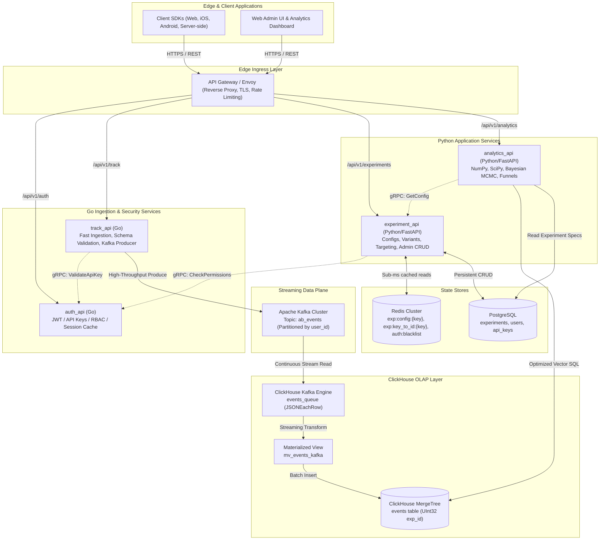
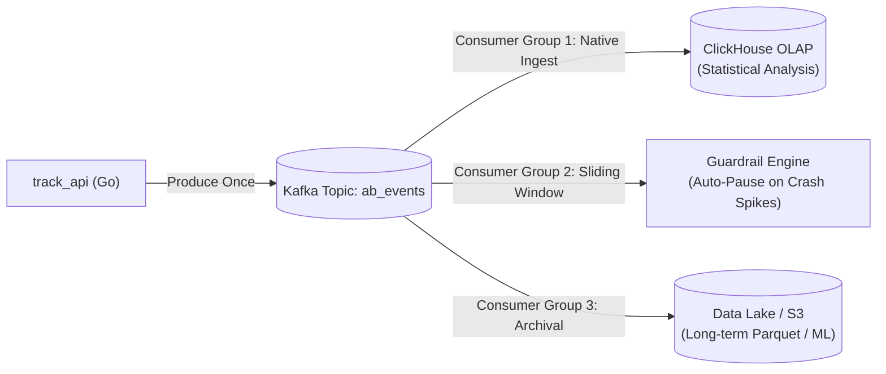

# SynaqCore — System Design Document (SDD)

**Document Version:** 1.0.0  
**Status:** Approved Architecture  
**Target Platform:** High-Throughput Distributed A/B/n Experimentation & Real-Time Analytics  
**Last Updated:** October 2026  

---

## 1. Executive Summary & System Objectives

**SynaqCore** is a high-performance, distributed, server-side A/B/n experimentation and real-time statistical analytics platform. It enables engineering, product, and data teams to safely deploy feature flags, allocate users deterministically across variants, and evaluate business metrics with statistical rigor.

### 1.1 Core System Capabilities
1. **Ultra-Low Latency Variant Allocation:** Sub-millisecond deterministic bucketing ($< 2\text{ ms}$ at p99) via MurmurHash3 / SHA-256 without database lookups on the critical request path.
2. **High-Throughput Ingestion:** Ingesting hundreds of thousands of analytical telemetry events per second ($100\text{k}+\text{ EPS}$) with zero event loss.
3. **Automated Columnar Streaming:** Native, zero-maintenance ingestion from message logs directly into ClickHouse OLAP tables.
4. **Advanced Statistical Engine:** Real-time computation of Frequentist metrics (Z-test, Welch's t-test, $p$-values, confidence intervals), Bayesian simulations ($P(B > A)$, Expected Loss), Sample Ratio Mismatch (SRM) validation, and automated Guardrail circuit breakers.

### 1.2 System Level Indicators & Objectives (SLI / SLO)
* **Variant Evaluation (`/variant`):** $p99 \le 2\text{ ms}$, availability $\ge 99.99\%$.
* **Event Ingestion (`/track`):** $p99 \le 3\text{ ms}$, availability $\ge 99.99\%$.
* **Data Freshness:** Telemetry visible in analytical aggregates within $\le 5\text{ seconds}$ of occurrence.
* **Durability:** Zero event loss once acknowledged by the ingestion gateway.

---

## 2. High-Level Architecture Topology

The platform separates the **High-Throughput Ingestion Plane (Go)**, the **Streaming Event Backbone (Apache Kafka)**, the **Columnar Storage Layer (ClickHouse)**, the **Deterministic Variant & Metadata Plane (Python/PostgreSQL/Redis)**, and the **Scientific Compute Engine (Python/SciPy)**.



---

## 3. Deep Dive: Why Apache Kafka for A/B Testing?

In an experimentation system, the telemetry stream behaves fundamentally differently from standard transactional web requests. Apache Kafka serves as the central data backbone for six critical reasons:

### 3.1 The 1:50 Asymmetric Traffic Amplification
In A/B testing:
* A user requests their experiment variant **once** per session (e.g., `GET /variant/paywall_v2`).
* During that session, the user generates **dozens to hundreds of events**: `page_view`, `scroll_depth_50`, `click_cta`, `view_pricing`, `add_to_cart`, `payment_error`, `purchase`.
* A platform with 2,000 active concurrent users evaluating experiments generates over **100,000 events/second**.

Kafka is designed specifically for this high-write, append-only profile using sequential disk I/O and kernel page caching.

---

### 3.2 ClickHouse Shock Absorber & Batching Buffer
ClickHouse is a columnar OLAP database optimized for reading billions of rows and aggregating numbers in milliseconds. However, ClickHouse has a strict operational constraint:
> **ClickHouse cannot process millions of single-row HTTP INSERT statements.**  
> Doing so creates millions of tiny unmerged parts on disk, resulting in:  
> `DB::Exception: Too many parts in all data parts in table (300). Merges are processing significantly slower than inserts.`

* **How Kafka solves this:**  
  Kafka acts as an elastic buffer. When a flash sale or push campaign spikes traffic to 200,000 EPS, `track_api` dumps events into Kafka without latency spikes.  
  ClickHouse uses its internal `ENGINE = Kafka` consumer to pull these events in **large, healthy micro-batches** (e.g., 50,000 to 100,000 rows every 1–2 seconds) and writes them directly into optimized `MergeTree` parts.

```
[ 150,000 HTTP Requests/sec ]
            │
            ▼
    [ track_api (Go) ]
            │ (Async Produce, sub-millisecond return)
            ▼
     ┌──────────────┐
     │ Apache Kafka │  <--- Absorbs bursts, zero backpressure to mobile apps
     └──────┬───────┘
            │
            │ (Native pull: 50,000 rows micro-batch)
            ▼
     [  ClickHouse  ]  <--- Healthy merges, zero "Too many parts" crashes
```

---

### 3.3 Strict Causal Ordering per User via Partitioning (Essential for Funnels)
In A/B testing, **conversion funnel analysis** depends on preserving exact chronological sequence:
$$\text{variant assigned} \longrightarrow \text{view\_product} \longrightarrow \text{add\_to\_cart} \longrightarrow \text{checkout} \longrightarrow \text{purchase}$$

In traditional distributed task queues (like RabbitMQ or SQS with multiple workers), worker prefetch and concurrent task execution scramble message ordering. A `purchase` event can easily be processed and saved before the `add_to_cart` event.

* **How Kafka solves this:**  
  `track_api` specifies the `user_id` as the **Kafka message key**:
  $$\text{Target Partition} = \text{Murmur2}(\text{user\_id}) \pmod{\text{Total Partitions}}$$
  All events generated by a given user are guaranteed to land on the **exact same partition**. Within a partition, Kafka guarantees strict FIFO ordering. Funnel queries in ClickHouse reconstruct user sessions with 100% causal integrity.

---

### 3.4 Zero-Overhead Consumer Fan-out (ClickHouse + Guardrails + Cold Storage)
In a mature A/B testing infrastructure, incoming telemetry is needed by multiple independent systems simultaneously:



1. **ClickHouse (`clickhouse_ab_events_cg`):** Consumes events for statistical reporting and dashboards.
2. **Real-time Guardrail Service (`guardrail_alerts_cg`):** Evaluates sliding 1-minute windows. If Variant B triggers an abnormal surge in `app_crash` or `http_500` events, the guardrail system automatically disables the experiment variant in Redis within 15 seconds.
3. **Data Lake Archival (`s3_archiver_cg`):** Writes hourly Parquet partitions to S3 for cold data compliance and training predictive ML models.

* **Kafka vs Traditional Message Brokers:**  
  In RabbitMQ, routing a message to 3 separate destinations requires 3 independent queues in memory, multiplying memory, network, and disk write I/O by $3\times$.  
  In Kafka, data is appended to disk **once**. Any number of consumer groups can read the stream at their own pace with zero overhead to producers or database storage.

---

### 3.5 Event Replayability: Disaster Recovery & Analytics Migration
In destructive queue architectures (RabbitMQ, SQS), once an event is read and acknowledged (`ACK`), **it is permanently destroyed**.

* **The A/B Testing Catastrophe:**  
  Suppose an engineer introduces a bug in the tracking schema, or an analyst discovers that ClickHouse was partitioned incorrectly, or an accidental table drop occurs. In a destructive queue, 30 days of irreplaceable experiment history are lost forever.
* **The Kafka Solution:**  
  Kafka is an **immutable, persistent commit log**. Events are retained on disk for a configurable retention window (e.g., 14 or 30 days).  
  If analytical data is corrupted, ClickHouse can simply recreate the table, **reset its consumer offset to timestamp $0$**, and replay weeks of telemetry in minutes.

---

### 3.6 Architecture Comparison: Kafka vs RabbitMQ for A/B Testing

| Capability | RabbitMQ | Apache Kafka | Architectural Impact on A/B Testing |
| :--- | :---: | :---: | :--- |
| **Data Retention** | Ephemeral (Deleted on ACK) | **Immutable Log (7–30 days)** | Allows event replayability upon schema change, table corruption, or bug discovery. |
| **ClickHouse Ingest** | Requires custom consumer worker daemon | **Native `ENGINE = Kafka`** | Eliminates manual Python/Go worker; zero OOM risk, automatic offset commits. |
| **Throughput Ceiling** | ~25,000–40,000 EPS | **500,000+ EPS** | Effortlessly handles sudden viral traffic spikes and mass push notifications. |
| **User Ordering** | Non-deterministic across workers | **Guaranteed FIFO per `user_id`** | Preserves accurate event sequencing for multi-step funnel analysis. |
| **Fan-out Cost** | Multiplies RAM & disk writes ($N\times$) | **Zero overhead ($1\times$ storage)** | Simultaneously streams to ClickHouse, Real-Time Guardrails, and S3 Data Lake. |
| **I/O Mechanism** | Random RAM/Disk structures | **Sequential I/O + `sendfile` Zero-Copy** | Sub-millisecond write latency, minimal CPU overhead on ingestion brokers. |

---

## 4. Experiment Identification Architecture (`id` vs `key` vs `name`)

To guarantee data integrity between client SDKs, relational storage, and analytical aggregates, SynaqCore implements a **3-Tier Identification Model**:

```
+----------------------------------------------------------------------------------------------------+
|                                    3-TIER IDENTIFICATION MODEL                                      |
+----------------------------------------------------------------------------------------------------+
| Tier 1: id       | Immutable Surrogate Primary Key  | BIGINT / BIGSERIAL (Postgres), UInt32 (ClickHouse)   |
| Tier 2: key      | Machine-Readable Unique Slug     | VARCHAR(64) UNIQUE NOT NULL (snake_case)           |
| Tier 3: name     | Human-Readable Display Title     | VARCHAR(255) NOT NULL (Mutable Display Label)      |
+----------------------------------------------------------------------------------------------------+
```

### 4.1 Tier Responsibilities
1. **`id` (`BIGINT` in Postgres, `UInt32` in ClickHouse):**
   - Technical surrogate key. Immutable for the lifetime of the entity.
   - Primary ordering and filtering key in ClickHouse (`WHERE experiment_id = 1042`). Using 4-byte integers instead of strings reduces columnar index RAM consumption by over $80\%$.
2. **`key` (`VARCHAR(64) UNIQUE NOT NULL`, e.g., `checkout_v2`):**
   - Developer-facing identifier used in client code: `abClient.getVariant("checkout_v2")`.
   - Redis cache key: `exp:config:checkout_v2`.
   - Deterministic hash salt: `MurmurHash3(user_id + ":" + key)`.
3. **`name` (`VARCHAR(255)`, e.g., "Red Checkout Button Test - Q4"):**
   - Display title in the administrative UI and reports. Can be changed at any time without impacting client code, caches, or analytical history.

### 4.2 Why `key` Must Be Strictly Unique
Allowing duplicate keys leads to catastrophic system failures:
* **API Ambiguity:** `GET /config/{key}` cannot resolve which experiment parameters to serve.
* **Cache Corruption in Redis:** `SET exp:config:{key}` causes Experiment B to silently overwrite Experiment A's targeting rules and traffic weights.
* **Hash Bucketing Correlation:** Because the salt is `user_id + ":" + key`, identical keys force identical bucket allocations across independent tests, completely invalidating sample randomness.
* **OLAP Metric Pollution:** Telemetry events for two different tests merge under the same key in ClickHouse, invalidating $p$-values and conversion metrics.

---

## 5. Storage Architecture & Schemas

### 5.1 ClickHouse Ingestion Schema (Native Kafka Engine)
```sql
CREATE DATABASE IF NOT EXISTS synaqcore;

-- 1. Virtual Kafka Queue Engine
CREATE TABLE IF NOT EXISTS synaqcore.events_queue (
    event_id UUID,
    experiment_id UInt32,
    variant LowCardinality(String),
    user_id String,
    event_name LowCardinality(String),
    timestamp DateTime64(3, 'UTC'),
    value Float64,
    properties String,
    environment LowCardinality(String)
) ENGINE = Kafka
SETTINGS kafka_broker_list = 'kafka:9092',
         kafka_topic_list = 'ab_events',
         kafka_group_name = 'clickhouse_ab_events_cg',
         kafka_format = 'JSONEachRow',
         kafka_num_consumers = 4,
         kafka_max_block_size = 65536;

-- 2. Target Columnar MergeTree Table
CREATE TABLE IF NOT EXISTS synaqcore.events (
    event_id UUID,
    experiment_id UInt32,
    variant LowCardinality(String),
    user_id String,
    event_name LowCardinality(String),
    timestamp DateTime64(3, 'UTC'),
    value Float64,
    properties String,
    environment LowCardinality(String)
) ENGINE = MergeTree()
PARTITION BY toYYYYMM(timestamp)
ORDER BY (experiment_id, event_name, toDate(timestamp), user_id, timestamp)
SETTINGS index_granularity = 8192;

-- 3. Streaming Materialized View
CREATE MATERIALIZED VIEW IF NOT EXISTS synaqcore.mv_events_kafka
TO synaqcore.events AS
SELECT
    event_id,
    experiment_id,
    variant,
    user_id,
    event_name,
    timestamp,
    value,
    properties,
    environment
FROM synaqcore.events_queue;
```

### 5.2 PostgreSQL Relational Schema
```sql
-- Core Experiments Table
CREATE TABLE IF NOT EXISTS experiments (
    id BIGSERIAL PRIMARY KEY,
    key VARCHAR(64) UNIQUE NOT NULL,
    name VARCHAR(255) NOT NULL,
    description TEXT,
    url VARCHAR(255),
    is_active BOOLEAN NOT NULL DEFAULT FALSE,
    variants JSONB NOT NULL,
    config JSONB NOT NULL DEFAULT '{}'::jsonb,
    created_at TIMESTAMPTZ NOT NULL DEFAULT NOW(),
    updated_at TIMESTAMPTZ NOT NULL DEFAULT NOW(),
    CONSTRAINT ck_experiment_key_format CHECK (key ~ '^[a-z0-9_]{3,64}$')
);

CREATE UNIQUE INDEX idx_experiments_key ON experiments(key);
CREATE INDEX idx_experiments_active ON experiments(is_active);
CREATE INDEX idx_experiments_variants_gin ON experiments USING gin(variants);

-- Users & Authentication Table (Go auth_api)
CREATE TABLE IF NOT EXISTS users (
    id UUID PRIMARY KEY DEFAULT gen_random_uuid(),
    email VARCHAR(255) UNIQUE NOT NULL,
    password_hash VARCHAR(255) NOT NULL,
    role VARCHAR(50) NOT NULL DEFAULT 'viewer' CHECK (role IN ('admin', 'editor', 'analyst', 'viewer')),
    is_active BOOLEAN NOT NULL DEFAULT TRUE,
    created_at TIMESTAMPTZ NOT NULL DEFAULT NOW(),
    updated_at TIMESTAMPTZ NOT NULL DEFAULT NOW()
);

-- API Keys Table
CREATE TABLE IF NOT EXISTS api_keys (
    id UUID PRIMARY KEY DEFAULT gen_random_uuid(),
    key_hash VARCHAR(64) UNIQUE NOT NULL,
    name VARCHAR(100) NOT NULL,
    user_id UUID NOT NULL REFERENCES users(id) ON DELETE CASCADE,
    scopes TEXT[] NOT NULL DEFAULT '{"track:write", "config:read"}',
    is_active BOOLEAN NOT NULL DEFAULT TRUE,
    expires_at TIMESTAMPTZ,
    created_at TIMESTAMPTZ NOT NULL DEFAULT NOW(),
    last_used_at TIMESTAMPTZ
);
```

### 5.3 Redis Cache Namespace Architecture
* **`exp:config:{key}`** (String / JSON): Complete active experiment payload (weights, targeting rules, variant configs). TTL: 1 hour, invalidated on CRUD updates.
* **`exp:key_to_id:{key}`** (String / Int): Fast mapping from slug `key` to `UInt32 id` used by `track_api` to enrich events before Kafka publishing.
* **`auth:blacklist:{jti}`** (String / Byte): Revoked JWT tokens checked by `auth_api`.
* **`auth:apikey:{key_hash}`** (String / JSON): In-memory cache of API key permissions to eliminate PostgreSQL lookups on telemetry ingest.

---

## 6. Inter-Service Communication: REST vs gRPC

SynaqCore strictly separates **North-South** and **East-West** communication patterns:

```
[ Outside World ] ──────────────► [ API Gateway ] ──────────────► [ Go / Python Services ]
                    REST / JSON                     gRPC / Protobuf
                   (North-South)                     (East-West)
```

1. **North-South (External Ingress):**
   - Exposed as standard **HTTPS REST / JSON** APIs via the API Gateway.
   - Ideal for web apps, mobile SDKs, server clients, and third-party webhooks.
2. **East-West (Internal Microservices):**
   - Implemented exclusively via **gRPC (HTTP/2 + Protocol Buffers)**.
   - Used for internal token authentication checks (`track_api` $\to$ `auth_api`), permission validation (`experiment_api` $\to$ `auth_api`), and metadata exchange.
   - Provides binary serialization (zero JSON parsing overhead), connection multiplexing, and strictly typed contracts.

---

## 7. Operational Resilience & Fault Tolerance

1. **Kafka Outage / Partition Degraded:**  
   `track_api` maintains a bounded in-memory ring buffer (up to 50,000 events). If Kafka experiences temporary partition rebalancing, events are buffered in memory and flushed automatically upon broker reconnect.
2. **ClickHouse Backpressure:**  
   If ClickHouse executes heavy background data merges, the native Kafka engine automatically adjusts its polling pace without dropping messages from the Kafka log.
3. **Redis Cache Failure:**  
   If Redis becomes unreachable, `experiment_api` falls back gracefully to PostgreSQL with circuit breaking to prevent database exhaustion.
4. **Dead Letter Queue (DLQ):**  
   Any malformed event that fails JSON parsing in ClickHouse is bypassed (`kafka_skip_broken_messages = 100`) and routed to an `ab_events_dlq` topic for offline inspection.
