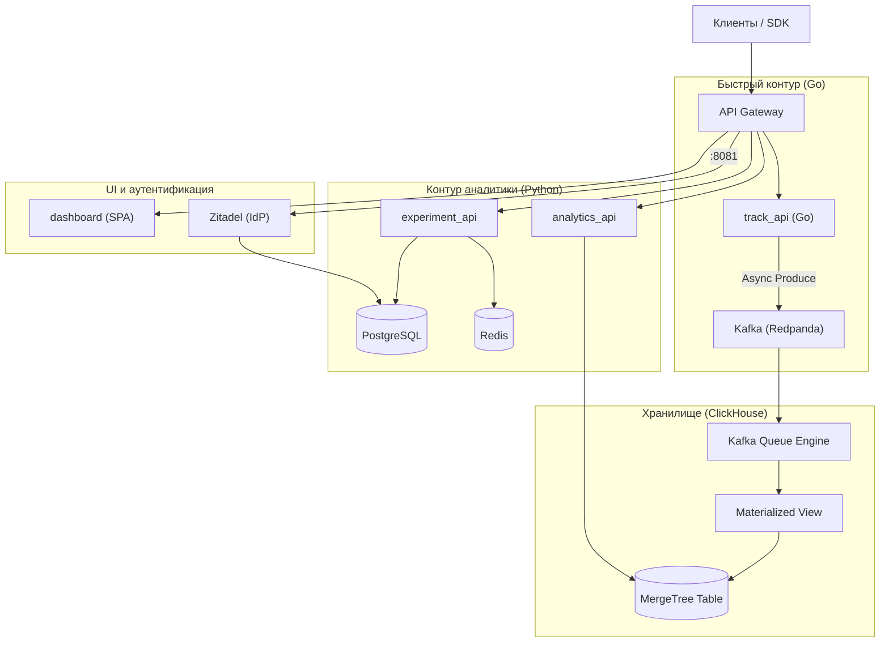

# Архитектура системы SynaqCore

Краткое руководство по архитектуре высоконагруженной платформы A/B-тестирования и аналитики.

---

## 1. Обзор архитектуры

Система разделена на два контура:
1. **Быстрый контур сбора данных (Go + Kafka + ClickHouse):** Приём 100k+ событий в секунду с задержкой p99 < 3 мс.
2. **Контур аналитики и экспериментов (Python + Postgres + Redis):** Расчёт статистики (частотный анализ, Байес), таргетинг и админка.

---

## 2. Компоненты сервиса

| Компонент | Стек | Роль |
| :--- | :--- | :--- |
| **track_api** | Go (Gin, franz-go) | Быстрый приём телеметрии, валидация JSON, асинхронный сброс в Kafka. |
| **Kafka (Redpanda)** | Redpanda | Распределённый лог событий, партиционирование по `user_id`. |
| **ClickHouse** | OLAP MergeTree | Колоночное хранение миллиардов событий, расчёт воронок и метрик. |
| **experiment_api** | Python (FastAPI) | Детерминированное распределение пользователей по вариантам, CRUD тестов. |
| **analytics_api** | Python (SciPy/NumPy) | Математический расчёт доверительных интервалов, Z-test, Bayesian P(B > A). |
| **dashboard** | React + Vite + Tailwind (nginx-unprivileged) | SPA управления экспериментами и просмотра результатов, `/dashboard/`. |
| **Zitadel** | Go, OIDC/OAuth2 | Identity Provider: вход пользователей, выдача JWT, роли `admin` / `analyst`. |

---

## 3. Ключевые паттерны надёжности

1. **Детерминированное хеширование:** Вариант для пользователя вычисляется через `SHA-256(f"{user_id}:{experiment_name}") % 10000` без походов в базу.
2. **Zero-loss Ingestion:** `track_api` отдаёт `200 OK` сразу после записи в буфер памяти, фоновый поток пачками сжимает и пишет данные в Kafka.
3. **Безворкерный пайплайн в ClickHouse:** Отсутствуют промежуточные Python-консьюмеры. Данные переливаются из топика в таблицу силами связки `Kafka Engine -> Materialized View -> MergeTree`.
4. **Деградация при сбое Redis:** короткие таймауты (0.3 с, один повтор) и circuit breaker — после ошибки Redis пропускается на 5 с, конфиг читается из PostgreSQL. Чтобы сбой Redis нельзя было превратить в DoS на Postgres, gateway ограничивает `/api/v1/variants/` (`limit_req`, 50 r/s с IP, burst 100, сверх — `429`).

---

## 4. Аутентификация и авторизация (Zitadel)

- **IdP:** Zitadel в общем PostgreSQL (своя БД `zitadel`). Наружу публикуется отдельным портом gateway `127.0.0.1:8081`, а не префиксом пути: Zitadel не работает под префиксом, и его корневые пути (`/admin/v1`, `/management/v1`, `/ui/console`) конфликтуют с путями платформы. Issuer — `http://localhost:8081`.
- **Bootstrap:** одноразовый идемпотентный `zitadel-init` создаёт проект, роли `admin` / `analyst`, OIDC-приложение дашборда и сервисный аккаунт `synaq-automation` (роль `admin`). Публичный конфиг (issuer, project_id, client_id) пишется в `infra/zitadel/public/oidc.json`, секреты — в `infra/zitadel/secrets/`.
- **Потоки:** дашборд — Authorization Code + PKCE; скрипты и нагрузочные тесты — `client_credentials` (`scripts/get_token.sh`).
- **Проверка в API** (`src/core/auth.py` в `experiment_api` и `analytics_api`): только RS256, ключи из JWKS `http://zitadel:8080/oauth/v2/keys` (с подменой `Host`, т.к. Zitadel выбирает инстанс по Host) с кэшем и ограничением частоты перезапросов; проверяются `iss`, `aud` (= project_id из `oidc.json`), `exp`, обязательный `jti` (ID token как bearer не принимается). Роли — только из claim `urn:zitadel:iam:org:project:<project_id>:roles`. Fail closed: OIDC не настроен или JWKS недоступен → `503`.
- **RBAC:** создание / `PATCH` / удаление экспериментов — `admin`; список экспериментов и статистика — `admin` или `analyst`. Выдача вариантов и трекинг публичны.

---

## 5. Дашборд

- SPA на React + Vite + Tailwind, собирается в Docker-образе (multi-stage) и отдаётся `nginx-unprivileged`; CSP и прочие заголовки безопасности выставляет сам контейнер.
- Gateway проксирует `/dashboard/`; старый адрес `/admin` редиректит на `/dashboard/` (встроенная HTML-админка удалена).
- Вход через Zitadel (`oidc-client-ts`, PKCE), конфиг OIDC берётся из `oidc.json`. Токен передаётся в API как `Authorization: Bearer`.
- Экраны: список экспериментов со статусами, создание эксперимента (варианты и веса), карточка результатов (конверсия, победитель, uplift, p-value). Элементы управления скрываются по роли.
