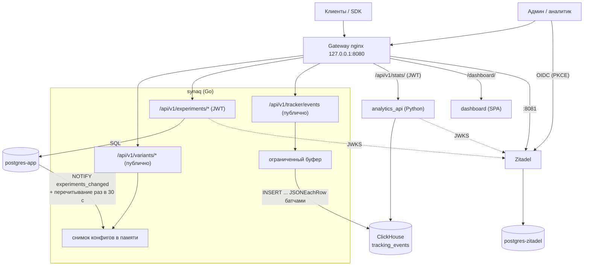

# Архитектура системы SynaqCore (lite)

Описание архитектуры платформы A/B/n-тестирования для ветки `lite`: один VPS, 2 vCPU / 4 ГБ. Обоснование
решений — в [ADR 0002](adr/0002-lite-go-monolith.md). Предыдущая распределённая схема (Python `experiment_api` +
Redis, Go-трекер → Redpanda → ClickHouse Kafka engine) доступна по тегу `v1-python`.

---

## 1. Обзор архитектуры

- **`synaq` (Go)** — один процесс на горячем пути: выдача вариантов из снимка конфигураций в памяти, admin API
  экспериментов (JWT Zitadel) и приём событий с батчевой записью напрямую в ClickHouse.
- **`analytics_api` (Python)** — статистика по ClickHouse, отдельный сервис (bulkhead): тяжёлые запросы не
  отнимают CPU у выдачи вариантов.
- **Хранилища:** `postgres-app` (эксперименты, источник истины), ClickHouse (события), `postgres-zitadel`
  (только IdP). Redis и брокера сообщений нет.

Целевые цифры производительности на эталонном стенде не измерялись; ориентир — ~1–2 тыс. событий/с.

---

## 2. Компоненты

| Компонент | Стек | Роль |
| :--- | :--- | :--- |
| **synaq** | Go (Gin, pgx, sqlc, goose) | Выдача вариантов (`/api/v1/variants/{name}`, `/batch`, `/active`, `/config/{name}`, `/eval-configs`) из снимка в памяти; CRUD экспериментов; приём событий (валидация, генерация `event_id`, батчевый INSERT в ClickHouse). Миграции Postgres применяются при старте. `/health` — процесс жив, `/readyz` — снимок загружен, `/health/track` — ClickHouse доступен. |
| **postgres-app** | PostgreSQL 16 | Таблица `experiments`, триггер `pg_notify('experiments_changed', ...)`. |
| **ClickHouse** | 24.8, `ReplacingMergeTree` | Хранение событий (`01-tables.sql`), агрегации для статистики; дедупликация по `event_id`. Конфиг урезан под малую память (`infra/clickhouse/config.d`, `users.d`). |
| **analytics_api** | Python (FastAPI) | `/api/v1/stats/`: z-тест, интервалы Уилсона, байесовский Монте-Карло, бизнес-метрики, сегменты, воронки. Движок без scipy/numpy. |
| **dashboard** | React + Vite + Tailwind (nginx-unprivileged) | SPA управления экспериментами и просмотра результатов, `/dashboard/`. |
| **Zitadel** + **postgres-zitadel** | Go, OIDC/OAuth2 | IdP: вход пользователей, JWT, роли `admin` / `analyst`. Собственный Postgres, отдельный от бизнес-данных. |
| **gateway** | nginx | Единственная точка входа, маршрутизация по префиксу, `limit_req`, CORS, раздача `/sdk/`. |

---

## 3. Ключевые паттерны надёжности

1. **Детерминированное хеширование.** `bucket = int(SHA-256(f"{user_id}:{experiment_name}"), 16) % 10000`; варианты
   перебираются в алфавитном порядке, выбирается первый, для которого `bucket * total < cumulative * 10000`
   (целые числа, без float). Порядок ключей не используется: Postgres JSONB его не сохраняет. Тот же алгоритм — в
   `sdk/python` и `sdk/go`; паритет с Python-сервером закреплён golden-векторами
   `apps/synaq/internal/allocation/testdata/golden.json`.
2. **Конфиги в памяти.** Горячий путь читает неизменяемый снимок одним `atomic.Load`, без БД и блокировок. Снимок
   заменяется после записи через admin API (read-your-writes), по `LISTEN experiments_changed` (дебаунс 50 мс),
   раз в 30 с полностью и после переподключения слушателя. Ошибка чтения из БД → раздаётся прежний снимок.
   Gateway стартует только после `/readyz` synaq (снимок загружен).
3. **Ограниченный буфер и backpressure.** Трекер отвечает `200` после постановки события в буфер (по умолчанию
   10 000 событий и 64 МиБ). Батчи по 1000 событий или раз в секунду, до 5 попыток записи, затем батч
   отбрасывается с логом. Буфер полон → `503` + `Retry-After: 1`, без блокировки и без роста памяти до OOM.
   ClickHouse не нужен для старта: при его недоступности synaq только логирует предупреждение, выдача вариантов
   и admin API работают, а `/health/track` показывает состояние приёмника.
4. **Окно timestamp.** События принимаются только в окне [сейчас − 7 дней, сейчас + 5 минут]: иначе одна вставка
   могла задеть слишком много месячных партиций, и ClickHouse отклонил бы весь батч.
5. **Лимиты на входе.** Gateway: `/api/v1/variants/` — 50 r/s с IP (burst 100), `/api/v1/tracker/` — 200 r/s
   (burst 400), сверх — `429`. Трекер: тело ≤ 64 КБ (`413`), строки ≤ 256 символов, `event_data` ≤ 16 КБ (`400`).
   HTTP-сервер synaq с полными таймаутами чтения/записи (защита от slowloris).
6. **Строгая валидация admin API.** Ошибки — `422` в формате FastAPI (`{"detail":[{"type","loc","msg"}]}`), но без
   lax-приведения типов: вес `"5"` или `5.0` — ошибка. Веса — целые 1..1 000 000; `PATCH` вариантов активного
   эксперимента → `409`.
7. **Bulkhead для аналитики.** Статистика вынесена в `analytics_api`, Монте-Карло — в `asyncio.to_thread`.
8. **Валидация параметров SQL.** Всё, что подставляется в запросы ClickHouse, проверяется (regex, экранирование,
   whitelist, целые числа); тексты ошибок ClickHouse только логируются. В synaq SQL к Postgres — только
   параметризованные запросы (sqlc), имя таблицы ClickHouse в `INSERT` зашито в код.
9. **Бюджет памяти.** У каждого контейнера `mem_limit` (сумма долгоживущих ~3.4 ГБ), Go-процессам задан
   `GOMEMLIMIT` ниже лимита.

---

## 4. Аутентификация и авторизация (Zitadel)

- **IdP:** Zitadel на собственном `postgres-zitadel`. Наружу — отдельным портом gateway `127.0.0.1:8081`, а не
  префиксом пути: корневые пути Zitadel (`/admin/v1`, `/management/v1`, `/ui/console`) конфликтуют с путями
  платформы. Issuer — `http://localhost:8081`.
- **Жизненный цикл:** `zitadel-dbinit` (единственный контейнер с учёткой суперпользователя Postgres) →
  `zitadel-setup` (первый инстанс, bootstrap-PAT) → `zitadel` → одноразовый идемпотентный `zitadel-init`
  (проект, роли `admin` / `analyst`, OIDC-приложение дашборда, сервисный аккаунт `synaq-automation`). Публичный
  конфиг (issuer, project_id, client_id) — в `infra/zitadel/public/oidc.json`, секреты — в `infra/zitadel/secrets/`.
  PAT после успешного bootstrap уничтожается.
- **Потоки:** дашборд — Authorization Code + PKCE; скрипты и нагрузочные тесты — `client_credentials`
  (`scripts/get_token.sh`, `make token`).
- **Проверка в API:** одна и та же логика в `apps/synaq/internal/auth` (Go) и `apps/analytics_api/src/core/auth.py`
  (Python) — меняйте обе. Только RS256, ключи из JWKS `http://zitadel:8080/oauth/v2/keys` (с подменой `Host`, т.к.
  Zitadel выбирает инстанс по Host), кэш и ограничение частоты перезапросов; проверяются `iss`, `aud`
  (= project_id из `oidc.json`), `exp`, обязательный `jti` (ID token как bearer не принимается). Роли — только из
  claim `urn:zitadel:iam:org:project:<project_id>:roles`. Fail closed: OIDC не настроен или JWKS недоступен → `503`.
- **RBAC:** создание / `PATCH` / удаление экспериментов — `admin`; список экспериментов и статистика — `admin`
  или `analyst`. Выдача вариантов и трекинг публичны.

---

## 5. Дашборд

- SPA на React + Vite + Tailwind, собирается в Docker-образе (multi-stage) и отдаётся `nginx-unprivileged`; CSP и
  прочие заголовки безопасности выставляет сам контейнер.
- Gateway проксирует `/dashboard/`; старый адрес `/admin` редиректит на `/dashboard/`.
- Вход через Zitadel (`oidc-client-ts`, PKCE), конфиг OIDC берётся из `oidc.json`.
- Экраны: список экспериментов, создание эксперимента (варианты и веса), карточка результатов (конверсия,
  победитель, uplift, p-value). Элементы управления скрываются по роли.

---

## 6. Решения

- [ADR 0002: lite — Go-монолит synaq на одном VPS](adr/0002-lite-go-monolith.md)
- [ADR 0001: Kafka (Redpanda) как брокер событий](adr/0001-kafka-vs-rabbitmq.md) — Python-версия и будущий профиль `scale`
- Приём событий и устройство ClickHouse: [clickhouse-kafka/README.md](clickhouse-kafka/README.md)
