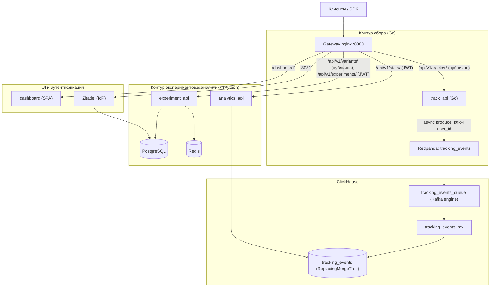

# Архитектура системы SynaqCore

Краткое описание архитектуры платформы A/B/n-тестирования и аналитики (ветка `main`).

---

## 1. Обзор архитектуры

Система разделена на два контура:
1. **Контур сбора данных (Go + Redpanda + ClickHouse):** приём событий трекером на Go, публикация в Kafka-топик,
   загрузка в ClickHouse силами самого ClickHouse (Kafka engine + materialized view), без промежуточных воркеров.
2. **Контур экспериментов и аналитики (Python):** `experiment_api` (Postgres + Redis) — CRUD экспериментов и выдача
   вариантов; `analytics_api` (ClickHouse) — статистика (частотный и байесовский анализ), изолированная от выдачи вариантов.

Целевые цифры производительности не измерялись на эталонном стенде; ориентиры для lite-варианта — в
[README](../README.md#main-vs-lite).

---

## 2. Компоненты

| Компонент | Стек | Роль |
| :--- | :--- | :--- |
| **track_api** | Go (Gin, franz-go) | Приём событий, валидация (размеры, окно timestamp), генерация `event_id`, если клиент его не передал, асинхронная публикация в Redpanda; при переполнении очереди — `503`. Альтернативный приёмник `EVENT_SINK=clickhouse` пишет напрямую в ClickHouse (для lite). |
| **Redpanda** | Kafka API | Журнал событий, топик `tracking_events` (4 партиции), партиционирование по `user_id`. |
| **ClickHouse** | `ReplacingMergeTree` | Хранение событий, агрегации для статистики; дедупликация по `event_id`. |
| **experiment_api** | Python (FastAPI) | Детерминированное распределение пользователей по вариантам, CRUD экспериментов. |
| **analytics_api** | Python (FastAPI) | `/api/v1/stats/`: z-тест, интервалы Уилсона, байесовский Монте-Карло, бизнес-метрики, сегменты, воронки. Движок без scipy/numpy. |
| **dashboard** | React + Vite + Tailwind (nginx-unprivileged) | SPA управления экспериментами и просмотра результатов, `/dashboard/`. |
| **Zitadel** | Go, OIDC/OAuth2 | Identity Provider: вход пользователей, выдача JWT, роли `admin` / `analyst`. |

---

## 3. Ключевые паттерны надёжности

1. **Детерминированное хеширование.** `bucket = int(SHA-256(f"{user_id}:{experiment_name}"), 16) % 10000`; варианты
   перебираются в алфавитном порядке (`sorted()`), выбирается первый, для которого `bucket * total < cumulative * 10000`
   (целые числа, без float). Порядок ключей словаря не используется: Postgres JSONB его не сохраняет, и вариант
   пользователя менялся бы между чтением из Redis и из Postgres. Тот же алгоритм реализован в `sdk/python` и `sdk/go`
   (golden-векторы в `sdk/go/synaq_test.go`).
2. **Ограниченная очередь и backpressure.** `track_api` отвечает `200 OK` после постановки события в ограниченную
   очередь продюсера (по умолчанию 10 000 сообщений); фоновая отправка батчами со сжатием zstd. Если очередь полна
   или брокер недоступен — `503` с `Retry-After: 1`, а не неограниченный рост памяти.
3. **Безворкерный пайплайн.** Нет промежуточных Python-консьюмеров: `Kafka engine → materialized view → ReplacingMergeTree`.
   Битые сообщения не блокируют топик (`kafka_handle_error_mode = 'stream'`, MV отбрасывает строки с `_error`).
4. **Окно timestamp.** События принимаются только в окне [сейчас − 7 дней, сейчас + 5 минут]: событие с произвольно
   старой датой могло задеть слишком много месячных партиций, и Kafka engine бесконечно повторял бы такой батч.
5. **Деградация при сбое Redis.** Короткие таймауты (0.3 с, один повтор) и circuit breaker — после ошибки Redis
   пропускается на 5 с, конфиг читается из PostgreSQL. Чтобы сбой Redis нельзя было превратить в DoS на Postgres,
   gateway ограничивает `/api/v1/variants/` (`limit_req`, 50 r/s с IP, burst 100, сверх — `429`). Трекер ограничен
   отдельно (200 r/s с IP, burst 400).
6. **Bulkhead для аналитики.** Статистика вынесена в `analytics_api`, Монте-Карло выполняется в `asyncio.to_thread`,
   поэтому тяжёлые запросы не влияют на выдачу вариантов.
7. **Валидация параметров SQL.** Всё, что подставляется в запросы ClickHouse, проверяется (regex, экранирование,
   whitelist, целые числа); тексты ошибок ClickHouse только логируются.

---

## 4. Аутентификация и авторизация (Zitadel)

- **IdP:** Zitadel в общем PostgreSQL (своя БД `zitadel`). Наружу публикуется отдельным портом gateway `127.0.0.1:8081`, а не префиксом пути: Zitadel не работает под префиксом, и его корневые пути (`/admin/v1`, `/management/v1`, `/ui/console`) конфликтуют с путями платформы. Issuer — `http://localhost:8081`.
- **Bootstrap:** одноразовый идемпотентный `zitadel-init` создаёт проект, роли `admin` / `analyst`, OIDC-приложение дашборда и сервисный аккаунт `synaq-automation` (роль `admin`). Публичный конфиг (issuer, project_id, client_id) пишется в `infra/zitadel/public/oidc.json`, секреты — в `infra/zitadel/secrets/`.
- **Потоки:** дашборд — Authorization Code + PKCE; скрипты и нагрузочные тесты — `client_credentials` (`scripts/get_token.sh`, `make token`).
- **Проверка в API** (`src/core/auth.py` в `experiment_api` и `analytics_api`, код продублирован): только RS256, ключи из JWKS `http://zitadel:8080/oauth/v2/keys` (с подменой `Host`, т.к. Zitadel выбирает инстанс по Host) с кэшем и ограничением частоты перезапросов; проверяются `iss`, `aud` (= project_id из `oidc.json`), `exp`, обязательный `jti` (ID token как bearer не принимается). Роли — только из claim `urn:zitadel:iam:org:project:<project_id>:roles`. Fail closed: OIDC не настроен или JWKS недоступен → `503`.
- **RBAC:** создание / `PATCH` / удаление экспериментов — `admin`; список экспериментов и статистика — `admin` или `analyst`. Выдача вариантов и трекинг публичны.

---

## 5. Дашборд

- SPA на React + Vite + Tailwind, собирается в Docker-образе (multi-stage) и отдаётся `nginx-unprivileged`; CSP и прочие заголовки безопасности выставляет сам контейнер.
- Gateway проксирует `/dashboard/`; старый адрес `/admin` редиректит на `/dashboard/`.
- Вход через Zitadel (`oidc-client-ts`, PKCE), конфиг OIDC берётся из `oidc.json`. Токен передаётся в API как `Authorization: Bearer`.
- Экраны: список экспериментов со статусами, создание эксперимента (варианты и веса), карточка результатов (конверсия, победитель, uplift, p-value). Элементы управления скрываются по роли.

---

## 6. Решения

- [ADR 0001: выбор брокера событий — Kafka (Redpanda)](adr/0001-kafka-vs-rabbitmq.md)
- Сравнение `main` и планируемого lite-варианта — в [README](../README.md#main-vs-lite).
